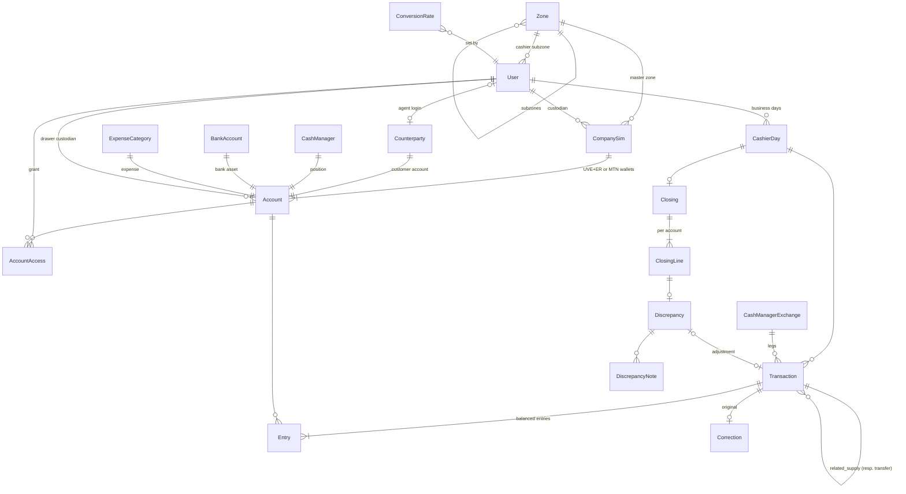

# Cashier Manager — design

Orange Cameroon distribution partner · FCFA (XAF) · Africa/Douala business dates · English/French.

## 1. Requirements consolidated

| Area | Rule as implemented |
|---|---|
| Scope | Company ↔ commercial agent and exceptional company ↔ POS transactions only. No end-user sales, agent stock, agent→POS deliveries or routes. |
| Assets | Cash per drawer; UVE and ER as two wallets of each Orange business SIM; MTN float per MTN SIM; company bank accounts (for confirmed bank deposits). |
| Customer identity | Business SIM number (normalised to 9 digits `6XXXXXXXX`, unique). Internal integer primary keys everywhere. |
| Customer balance | One combined amount per agent/POS, shared by all cashiers. UVE/ER/cash supply totals are reported separately; payments are never allocated to products. Negative balance = "supply due to customer". |
| Confirmed only | No pending / recipient-confirmation workflow. Duplicate prevention and atomic posting are technical safeguards only. |
| 1:1 | Supplies, payments, cash-manager exchanges are 1:1, no fees, no commissions. Only UVE→ER conversion has an uplift (stored rate). |
| Destockage | Drawer cash ↓, agent debt ↑, company UVE unchanged, POS recorded but owes nothing. Later UVE repayment is an ordinary UVE collection. |
| Direct POS supply | POS owes unless the cashier explicitly assigns an agent at entry. Responsibility can later move in full. |
| Expenses | Drawer cash ↓; categories configurable; Orange pre-finance is just a category; never touches agent debt. |
| Corrections | Managers/finance managers only; reversal + optional replacement; original stamped CORRECTED; nothing edited or deleted. |
| Closing | Per cashier; actual cash/UVE/ER/MTN vs expected; next entries go to next business day; differences stay open until a manager/finance manager resolves them. |

### Inconsistencies found and how they were resolved

1. *"Each cashier has one Orange SIM" vs "ER must leave from the zone master SIM"* — Fako 2's own SIM is not a master, so Fako 2 could never supply ER. Resolved by explicit **account grants**: the super administrator grants Fako 2 use of the Fako master ER wallet. Entry permission never implies wallet access (requirement §3).
2. *"Closing balances become next opening balances"* vs *"do not absorb differences"* — see decision 2.
3. *Responsibility transfer of a single supply* vs *cumulative running accounts* — see decision 1.
4. *Bank deposits* are a payment method but no bank asset was listed — bank accounts are modelled as company asset accounts (not counted at cashier closing).

## 2. Open accounting decisions (defaults built; please confirm)

| # | Question | Default implemented | Where |
|---|---|---|---|
| 1 | Responsibility transfer after part of a POS's debt was paid | Always moves the **full supply amount**; **refused** if the current party owes less than that amount, so settled debt never moves. | `operations.transfer_responsibility` |
| 2 | Carry-forward when closing shows a difference | **Book (expected) balance carries forward.** Difference becomes an open Discrepancy; later closings show it as "carried unresolved" and only a *change* creates a new discrepancy. | `services/closing.py` |
| 3 | Shared master wallet reconciliation | **Confirmed by the owner:** the master SIM is assigned to one **cashier in charge**; only that cashier uses it and it is counted in that cashier's subzone closing. All other accounts belong to a zone, not to a cashier. | `CompanySim.custodian`, `zone_closing_accounts` |
| 4 | "Corresponding master zone" for ER | Master zone of the **cashier entering** the supply. | `build_supply` |
| 5 | UVE→ER conversion destination | **Same Orange SIM**. ER = UVE × (1 + rate), **ROUND_HALF_UP to whole FCFA** (12 345 → 12 839). ER is not moved by internal transfer. | `build_conversion`, `money.py` |
| 6 | Who enters what | Cashiers enter all operations; managers/finance correct, resolve, transfer responsibility; only the super admin enters opening balances and rates. | `services/permissions.py` |

### Cash managers, wallets and openings (28/10/2026)

- Cash-manager exchanges are 1:1: cash or MTN float against UVE, or UVE against cash (see below). Older exchanges recorded without a direction accept cash or UVE on either side.
- **Accounts › Add** creates cash drawers, **UVE wallets** and **MTN float wallets** for a subzone (a UVE or MTN account is created through its SIM, so the SIM number is asked). The master SIM (ER) is added in Company sims: it belongs to the master zone (e.g. Fako, covering Fako 1 and Fako 2) and is operated by its cashier in charge.
- **Opening balances** are entered on a grid of the control accounts — cash, UVE and ER — by master zone and subzone/master SIM, with totals per column, per zone and the **total opening**. All typed amounts are posted together (all or nothing, idempotent). Agents/POS, cash managers, MTN float and banks are still entered one at a time below the grid.
- **Expenses** can be settled from a cash drawer, a UVE wallet or an MTN float wallet.
- **Agent/POS pickers** (supply, payment, destockage, responsibility transfer) lead with the **microzone**, then the name, SIM and subzone, and search by microzone, name or SIM — agents can be moved, the microzone stays.
- **Payments with several methods**: the payment form has one amount per method — Cash, UVE, MTN float, Bank deposit (with reference; bank account chosen automatically when there is one) — and shows the total. Each method is posted as its own collection into the subzone's account for that method, all together (all or nothing), sharing a payment group and **one receipt** that lists every part and the total. Reports by method keep working, and a mistaken part can be corrected on its own.
- **Supplies with several products**: Supply to agent and Supply to POS have one amount per product — Cash, UVE, ER — and show the total. Cash leaves the subzone's drawer, UVE its UVE wallet and ER the master SIM of the master zone (cashier in charge only), automatically. Each product is its own supply (so the supply reports by product keep working), posted together with one group and **one receipt** listing every part and the total.
- **One combined debt**: an agent or POS has a single combined balance. Payments and agent/POS opening balances are one amount, not split into UVE, Cash or ER (supplies still record their product for the supply reports).
- **Automatic accounts**: when the subzone has exactly one matching account, it is chosen automatically and shown as a line, not a list — payments go to the account of the payment method (cash → drawer, UVE → UVE wallet, MTN → MTN float, bank → the bank when there is one), supplies leave from the wallet of the product, and any single-choice account list fills itself. The server applies the same rule if the field arrives empty; a list appears only when there is a real choice.
- **Exchange sides are automatic**: the cashier picks what the company gives — cash or MTN float (then it is served UVE) or UVE (then it is served cash). The give and served-into accounts are the subzone's accounts of those kinds, filled in automatically; later legs on the exchange page follow the same rule.
- **New cash-manager exchange** is one form: cash manager/bank, ref number, amount, the account the company gives from and the amount given now (default: the full amount), the date and amount served, the account served into, and a comment. It records the agreement and both legs at once; if only part is served (e.g. 8M of 10M) the **balance to be served** stays open on the exchange and is recorded later from the exchange page. Lists and the cash-manager report show the ref number, amount served and balance to be served.
- **Internal transfers** are only between MTN float, UVE or bank accounts, and only between two accounts of the same kind (MTN→MTN, UVE→UVE, bank→bank). Cash drawers and ER wallets are not transferred internally. The destination list follows the source's kind.
- Entry forms say when a subzone has no account of the needed kind yet, and who adds it.

### Shops (points of service)

Shops are separate from the cashiers' desks. Each shop (Configuration › Shops) has its own **cash drawer, UVE and ER** accounts (created automatically; its company SIM number is recorded on the shop), its **shop manager** (teller and controller of that shop) and the one **senior shop manager** over all shops. Finance, the senior manager and the super administrator see every shop (Shops overview: capital and activity per shop with totals; shop transactions; SIM retrievals; services count; stock). Shops never see the commercial agents' balances (the agent picker shows names only), the cashiers' transactions or reports; cashiers and junior managers do not see shop dealings.

Shop operations go through the same double-entry ledger, on the shop's accounts (`Transaction.shop`, no cashier or business day):

| Operation | Effect |
|---|---|
| Orange Money cash-in | UVE −, cash + (commission recorded, not posted) |
| Orange Money cash-out | UVE +, cash − (commission recorded) |
| Airtime sale (**normal** or **good deal**, stored as the subtype) | ER −, cash + |
| UVE→ER conversion | at the **shop rate** (separate from the cashiers' rate; set by the super admin on the main Conversion rate page — Shops' rate section — or by the senior shop manager in shop setup) |
| Appro (UVE from an agent) | UVE +; cash −, or owed to the agent if on credit |
| ER supply from an agent | ER +; cash − or UVE −, or owed to the agent if on credit |
| Destockage with an agent | UVE −; cash +, or **the agent owes the shop** if on credit |
| Agent pays the shop | the agent's debt to the shop −; cash + or UVE + |
| Pay an agent | owed to the agent −; cash − or UVE − |
| Transfer to a cashier (**UVE only**) | shop UVE −; the cashier's UVE wallet + — posted in that subzone's business day, so it shows on the cashier side too |
| Cashier: transfer to a shop | the cashier's UVE wallet −; shop UVE + (recorded by the cashier, visible to both sides) |
| Item sale | cash +, shop sales −; the chosen units (by IMEI / serial) become SOLD |

Counted services (OTT, MAX IT, identification update, ticket creation, … — added or removed by the senior shop manager / super admin) record only their number per day. A **SIM retrieval** registers the SIM, the new SIM serial, the person's name, ID type and number and contact. Items belong to **categories** (managed in shop setup) and have a price. Stock is kept **unit by unit with an IMEI / serial number** (`StockUnit`: in stock / sold / removed, each number registered once); a sale picks category → item → units and records the **client's full name, address, country of origin, identification type (national ID, passport, residence permit, receipt, other) and number, telephone and WhatsApp** (`ItemSale`), all shown on the receipt. Stock counted before serials were introduced must be re-entered with serials. Shop dealings with agents use a per-shop, per-agent **position** account (negative: the shop owes the agent; positive: the agent owes the shop) and never touch the agent's balance with the company. Shop accounts appear in the opening grid (Shops group) and in the finance reconciliation (SHOPS rows, included in the company total).

#### Segmented shops and shop administration (30/10/2026)
A shop can have several staff, each with **duties** (`User.shop_duties`; empty = all duties): Orange Money cash-in / cash-out · Airtime and UVE→ER conversion · Item sales and stock · Counted services and SIM retrieval · Commercial agents and transfers to cashiers. Example: one person on the Orange Money desk, another on airtime and everything else. Duties are enforced in the services (`shop_for(..., duty)`) and the pages (403), and each person's menu shows only their duties. The shop page lists every staff member with their duties and what they recorded in the period. The staff share the shop's cash drawer, UVE and ER accounts; each operation records who entered it.

The **senior shop manager** (and the super admin) has a **Shops & staff** page: add, edit (close/reopen) and delete shops; create shop staff logins (temporary password, changed at first sign-in), change their shop (transfer) and duties, reset passwords, deactivate/activate and delete accounts. In **Services, items & rate** they add, edit and delete services, categories and items. Anything with history (a shop with operations, stock or staff, a staff member who recorded something, a service/item/category already used) is never deleted: the app says so and it is deactivated instead. The senior cannot manage non-shop accounts or other senior shop managers (super admin only).

#### Shop shifts and daily reconciliation (30/10/2026)
**Shifts (attendance).** Every shop staff member opens a shift when starting work and closes it when leaving (`ShopShift`: opened/closed time, hours). Shop staff can only record (operations, services, retrievals, stock) during an open shift; the pages send them to **My shift** otherwise. One open shift per person; in a segmented shop the shifts run side by side. Whoever **takes over the till** (no other shift open) counts the cash and reads the UVE and ER balances on the shop SIM; whoever **hands it back** (last to close) counts again; the others may skip the counts. Each count is stored with the system balance at that moment, and the difference is shown (never posted). The senior shop manager can close a forgotten shift, with a reason. A staff member cannot be transferred to another shop during an open shift. **Attendance** page: days worked, shifts, hours per person, shifts still open and shifts closed by the senior; staff see only their own.

**Daily reconciliation** (per shop and business date; list of all shops per day plus a detail page): for cash, UVE and ER — system opening (end of the previous day) + money in − money out = system closing, next to the count at the first shift opening and the count at the last shift closing, with opening and closing differences; the operations of the day and how each moved cash, UVE and ER; commissions; services done; the day's shifts. Status: shift(s) still open · no closing count · difference · balanced. The senior shop manager **signs off** the day (`ShopDayReview`); a difference must be explained, and a day cannot be signed off while shifts are open. Finance, the senior manager and the super admin see all shops; staff see their own shop.

#### Cashiers and shops as two workspaces; services in one record (30/10/2026)
Finance, the senior manager and the super administrator switch between two **workspaces** at the top of the menu: **Cashiers** (home, agents & POS, transactions, cash managers, closings, differences, reports) and **Shops** (overview, transactions, retrievals, services, daily reconciliation, attendance, stock, setup). Each workspace shows only its own menu; shared pages (a receipt, passwords, administration) keep the last workspace. The cashiers' reports no longer include the shop accounts: the reconciliation by zone ends with **CASHIERS TOTAL**, and the only shop-related column there is "Transfers with shops" (UVE moved between a cashier and a shop). The shops' figures live in the Shops overview and the shops' daily reconciliation.

**Services done**: one form lists every active counted service with its own count box; the staff type how many of each were done and record them together (`count_services`, one `ServiceCount` per service with a count, in one transaction). The page also shows what was already recorded today.

#### Capital, shop reports and multi-item sales (30/10/2026)
**Capital** (finance manager, senior manager, super admin; menu "Capital" in both workspaces). Three movements, each with a description, the **source of the funds** (or, for a withdrawal, who / where it goes to) and the **purpose**:
* **Inject** — Dr the chosen company account (any cash drawer, UVE, ER, MTN float, bank or shop account) / Cr **Owner's capital** (new system account).
* **Withdraw** — Dr Owner's capital / Cr the account (balance checked).
* **Transfer** — Dr the receiving account / Cr the sending account, between any two company accounts (cashier subzones, master SIMs, banks, shops); same product, or cash ↔ bank.
A movement on a cashier-side account is posted in that subzone's open business day (the cashier sees it, the closing counts it); a shop account sets the shop on the entry (the shop sees it; its reconciliation and reports count it). The cashiers' reconciliation report has a "Capital movements" column so opening + movements = closing still holds. Capital movements can only be cancelled (reversal) and recorded again. The Capital page shows net capital (all time), injected, withdrawn, transferred and the list of movements.

**Shop reports** (Shops workspace › Shop reports; on screen, Excel, PDF): **Daily** (the day, by shop), **Weekly** (Monday–Sunday, by day and by shop), **Monthly** (by week and by shop), **Custom** dates (by day and by shop); all shops or one. Two tables per breakdown: *activity* (cash-in/out with counts, commission, airtime and good deal, conversions, item sales and units, services, SIM retrievals, staff hours) and *agents, cash control and balances* (appro, ER supply, destockage, paid to / by agents, UVE to / from cashiers, net capital, counted closing differences, closing cash/UVE/ER at the end of each line), plus services by type and summary tiles.

**Sales of several items**: one sale to one client can contain any number of units of any items. The page lists everything in stock by category and item (filter + search by item or IMEI/serial); the cashier ticks the units, the basket shows each item with its quantity, an editable unit price and the total; the client's details are entered once. Each item is posted as its own sale line, all lines sharing one group and **one receipt** that lists every item with its serials and the total.

#### Cash managers, report sections, duty-based views (30/10/2026)
**Cash managers** — the finance manager (and the super admin) add, edit (name, phone/SIM, notes, active) and delete cash managers on the Cash managers page. One with exchanges cannot be deleted (its account has entries): untick Active instead; inactive ones disappear from the exchange form.

**Shop report** now also has a **SIM retrievals** table (date, shop, SIM, new ICCID, person, ID, phone, recorded by) and an **Attendance summary** (per staff: duties, days worked, shifts, hours, still open, closed by the senior), plus a SIM retrievals tile and a staff-hours tile.

**Duty-based views** — a staff member who does not have every duty sees only what belongs to their duties, everywhere: transaction detail (404 otherwise), shop transactions list and its type filter, the shop page (activity, recent operations; agent positions only with the agents duty; services only with the services duty; no staff table), SIM retrievals and services pages (services duty), stock (sales duty), the daily reconciliation (their operations and their own shifts; the till balances stay visible) and the shop report (only the columns, tiles and tables of their duties, their own hours and attendance; "Your duties only" is shown). Capital and opening entries are only for staff with every duty. Operation → duty: cash-in/out → Orange Money; airtime, UVE→ER → Airtime; item sale → Sales; appro, ER supply, destockage, payments with agents, UVE to/from cashiers → Agents.

#### Optional cash manager SIM; admin tools cover the shops (30/10/2026)
* A cash manager's phone / SIM number is optional (several may have none; one given is still unique). Import matches a cash manager by SIM, or by name when no SIM; opening import accepts the name too.
* **Clear data** (super admin) has three scopes: **Shops only** (every entry with a shop or on a shop account — shop operations, transfers between shops and cashiers, capital on shops, with their corrections — plus shifts, day sign-offs, stock units and sales, services and SIM retrievals; shops, staff, items and the cashiers' data stay), **All transactions** (cashiers and shops, plus the same shop records) and **Everything** (also agents, POS, agent logins, cash managers and the shops' positions with agents). Deleting a single sale puts its units back in stock.
* **Import CSV / Excel** gains: **Shops** (code, name, zone, SIM, address, active), **Shop staff** (username, names, shop, duties or ALL, temporary password — changed at first sign-in), **Shop items** (category created if new, name, price), **Shop stock** (shop, item, IMEI/serials), **Shop transactions** (date, shop, CASHIN / CASHOUT with commission, AIRTIME / GOOD_DEAL, CONVERT, SERVICE count), and shop opening balances (SHOP_CASH / SHOP_UVE / SHOP_ER + shop code). Templates for each are downloadable; the dry run checks every row before anything is posted.

#### Shop opening balances (30/10/2026)
Shops have their own **Shop opening balances** page (Shops workspace; super administrator, like the cashiers' page): a grid with one line per shop (cash drawer, UVE, ER) with live totals, recorded together for a go-live date; and the shops' **positions with commercial agents** (the agent owes the shop, or the shop owes the agent), one at a time on the shop–agent position account (`SHOP_PAYABLE` is now an opening kind; never touches the agent's balance with the company). Each account opens once (later changes go through a correction). Shop openings carry the shop, so the shop sees them (staff with every duty); the cashiers' opening page no longer lists shop accounts.

### Users & passwords

- Passwords are stored hashed: nobody — not even the super administrator — can read them. The super administrator's **Users & passwords** page (Administration) lists every user with role, zone, staff ID, last sign-in and status, and lets them **reset** a password (a strong one generated and shown once, or one they type, checked against the password rules), optionally forcing the user to choose their own at next sign-in, and **deactivate / activate** accounts (deactivation signs the user out at once; you cannot deactivate yourself or the last active super administrator). Every action is in the audit log.
- Every user can change their own password from **My password** (under their name in the menu); the current password is required.

### Company profile (multi-partner installations)

The application is not tied to one distribution partner. Each installation has one **company profile** (Administration › Company profile, super administrator only): name, optional tagline, address, city, phone, email, NIU, RCCM, receipt footer and logo. The logo is validated (PNG/JPEG/WEBP/GIF, ≤ 3 MB), trimmed, resized to ≤ 600 px and stored as PNG **in the database**, so it survives redeploys on hosts with an ephemeral disk. It appears in the menu, login page, browser tab, HTML/PDF receipts and PDF/Excel reports. The optional `COMPANY_NAME` / `COMPANY_ADDRESS` settings only pre-fill a new installation.

## 3. Stack

Django 5.2 + PostgreSQL 16. Chosen for: mature migrations, built-in authentication (salted PBKDF2 hashing), CSRF protection, server-rendered EN/FR i18n, an admin for configuration, and PostgreSQL row locks, partial unique indexes and constraint triggers for ledger safety. ReportLab (A4 PDFs), openpyxl (Excel). No JavaScript framework: forms work on low-end phones; small inline scripts only filter options.

## 4. Schema and relationships

Key constraints (all in migrations):

* `Counterparty.business_sim` unique (normalised); `CompanySim.msisdn` unique.
* One master SIM per master zone (partial unique index); only Orange SIMs can be master.
* One UVE/ER/MTN wallet per SIM; singleton system accounts; check constraints tying each account kind to its owner.
* One OPEN `CashierDay` per cashier (partial unique); one day per cashier per date.
* `Transaction.amount > 0`; `idempotency_key` unique; `reference` and `receipt_no` unique (PostgreSQL sequences); one opening balance per account; reversal must reference its original; bank collections need a reference.
* `Entry.amount ≠ 0`; indexes on `(account, business_date)` and `(account, id)`.
* **Triggers:** transactions and entries are append-only (UPDATE/DELETE raise); a deferred constraint trigger rejects any transaction whose entries do not sum to zero; another rejects any company asset account going negative.
* Money: `NUMERIC(18,0)` + Python `Decimal`; floats rejected by `to_money`.

## 5. Posting matrix (Dr = +, Cr = −)

| Type | Debit | Credit | Notes |
|---|---|---|---|
| Supply UVE | Customer (responsible) | UVE wallet (any Orange SIM the cashier may use) | receipt |
| Supply ER | Customer | ER wallet of the cashier's master-zone **master SIM** | receipt |
| Supply cash | Customer | Cash drawer | receipt |
| Destockage | Customer (**agent**) | Cash drawer | POS stored as `counterparty_2`; no POS debt; company UVE unchanged; receipt |
| Collection cash / UVE / MTN / bank | Drawer / UVE / MTN / bank | Customer (payer) | receipt; bank reference unique per bank |
| Responsibility transfer | Customer (new) | Customer (old) | full supply amount; no asset entry |
| Cash manager – company gives | Cash-manager position | Drawer or UVE (per direction) | posted only when it happens |
| Cash manager – company receives | Drawer or UVE | Cash-manager position | |
| UVE→ER conversion | ER wallet (UVE×(1+r)) | UVE wallet (UVE); Conversion uplift (UVE×r) | rate stored on the transaction |
| Expense | Expense category | Cash drawer | |
| Internal transfer | Destination asset | Source asset | same kind, or drawer↔bank; ER only within one master zone |
| Opening balance | Target account (±) | Opening equity | once per account |
| Reconciliation adjustment | Shortage: Recon adj. / Surplus: asset | Shortage: asset / Surplus: Recon adj. | only via discrepancy resolution |
| Reversal | exact negation of original | | correction |

Checks against the requirement examples (all are automated tests): supply 100 000 UVE → debt +100 000, UVE −100 000; collect 60 000 cash → debt −60 000, drawer +60 000; collect 40 000 MTN → debt −40 000, MTN +40 000; destockage 100 000 → drawer −100 000, agent +100 000, UVE 0, POS 0; then UVE payment 100 000 → UVE +100 000, agent 0 (one destockage, no supply: no double count); owes 100 000, pays 120 000 → balance −20 000 shown as supply due, payment kept at 120 000; 100 000 UVE converted → 104 000 ER.

Supplies are **not revenue**: they only move value from a company asset to a customer receivable. Revenue-like conversion uplift, expenses, cash-manager positions and reconciliation adjustments each have their own account class.

## 6. Role matrix (enforced server-side in services *and* views)

| Action | Super admin | Senior manager | Junior manager (own master zone only) | Finance mgr | Cashier | Agent |
|---|---|---|---|---|---|---|
| Configure zones, SIMs, drawers, users, grants, categories (add / edit / delete) | ✔ | |  | | | |
| Change conversion rate, opening balances | ✔ | |  | | | |
| Record supplies, destockage, payments, expenses, transfers, conversions, exchanges | ✔ (for a chosen cashier) | |  | | ✔ (accounts of own subzone; master SIM only if in charge) | |
| Register agent/POS | ✔ | ✔ | ✔ | ✔ | ✔ | |
| Responsibility transfer | ✔ | ✔ | ✔ (own zone) | ✔ | ✔ | |
| Corrections (reverse + replace, keeps history) | ✔ | ✔ | ✔ (own zone) | ✔ | | |
| **Hard edit in place / delete a transaction** | ✔ | |  | | | |
| **Clear data** (transactions, or everything) | ✔ | |  | | | |
| **Import CSV / Excel** (agents, POS, cash managers, opening balances, transactions) | ✔ | |  | | | |
| Audit log | ✔ | |  | | | |
| Close the subzone day | | |  | | ✔ | |
| Resolve discrepancies | ✔ | ✔ | ✔ (own zone) | ✔ | | |
| Reports | all zones | all zones | own zone, no company total | all zones + company reconciliation | own subzone + shared customer balances | own statement only |

### Super-administrator overrides (added at the owner's request)

The ledger tables stay append-only for everyone. The only exception is the super-administrator service (`core/services/admin.py`), which opens the database lock with `SET LOCAL core.admin_override` for one database transaction. Even then:
- a transaction is deleted or edited as a whole, so the ledger stays balanced;
- drawers, wallets and banks cannot go negative;
- the full before/after state is written to the audit log.

Editing a transaction of a day that is already closed changes that day's book balance, so the stored closing comparison no longer matches. Use corrections whenever history must be preserved.

Every transaction stores its **recording cashier** (`Transaction.cashier`), and every user has a **staff ID** (e.g. `CSH-0004`). Both are shown in lists, receipts, statements and exports. When the super admin records for a cashier, the cashier is the recording cashier and the super admin is kept as `entered_by`.

### Zones (owner's rules)

- A **master zone** (e.g. Fako) groups **subzones** (Fako 1, Fako 2). In Configuration they are separate: **Master zones** (with their subzones listed and added on the same page) and **Subzones** (each must choose its master zone; only master zones are offered). A subzone can be turned into a master zone from its page ("Make this zone a master zone") or with the list action, unless cashiers, drawers, SIMs, microzones or entries use it as a subzone (the message names them). The super administrator can add, update and delete master zones and subzones (also from the master zone page). Deleting a master zone deletes its unused subzones and microzones with it; anything still using a zone (cashiers, accounts, SIMs, business days, entries, agents/POS in a microzone) blocks the deletion and is listed by name — deactivate the zone instead to keep its history. The Subzones list has a check column that flags zones placed under a non-master zone or with zones under them, and the errors name the zones to fix. Subzones depend on their master: reports, dashboards and reconciliation roll subzones up into the master, and the master into the company.
- **Accounts are general, not a cashier's**: drawers and SIM wallets belong to a zone (`Account.zone`). Every cashier of a subzone uses that subzone's accounts. The only exception is the **master SIM**, which is assigned to its **cashier in charge**.
- **Entries are separated by zone**: every transaction stores its subzone (`Transaction.zone`) and its recording cashier.
- **Microzones**: every subzone is divided into microzones (`MicroZone`), each controlled by one **commercial agent**. A POS belongs to a microzone, so its agent in charge is known; an agent is registered with the microzone he controls (a new microzone can be created from the registration form). Microzones are shown on the agents list, filters and customer reports.
- **Senior manager** sees everything. **Junior manager** is assigned one master zone and sees, corrects and resolves only inside it (dashboard, transactions, closings, differences, reports); other zones return 404.
- **Finance manager** sees the reconciliation for each zone and the global **company** reconciliation (zone table with COMPANY TOTAL, then company assets).

## 7. Closing rules

1. Every entry belongs to its subzone's single OPEN business day, shared by all cashiers of the subzone (`posted_at` keeps the real timestamp).
2. Closing is done **per subzone** by any of its cashiers: it locks the subzone's accounts plus the master SIM of a cashier in charge in that subzone, computes expected = ledger balance, records actual, difference, carried-unresolved and new difference, closes the day and immediately opens the next business date (`max(today, previous + 1)`).
3. Closing is a blind count: expected values are shown after submission.
4. No movement is invented. Only a manager/finance manager resolution can post a reconciliation adjustment, linked to the discrepancy with notes, user and date. Alternatives: link a correction, or record a counting error (no posting).
5. Weekly/monthly/custom/overall reports are views over the same ledger; nothing needs approval.

## 8. Correction rules

1. Allowed for managers/finance managers on supplies, destockage, collections, expenses, transfers, conversions, cash-manager legs and opening balances; responsibility transfers can only be cancelled.
2. Posts a reversal (and optional replacement re-validated with the original cashier's permissions and zone; conversions keep their original rate) in one database transaction; overspending is checked on the net effect.
3. Posted on the **current open day of the original cashier**, with `original_business_date`. Established closings are never rewritten; the closing page lists corrections posted later for that day, and the next closing absorbs them as movements.
4. A supply whose responsibility was transferred must have the transfer cancelled first, so customer balances stay consistent.
