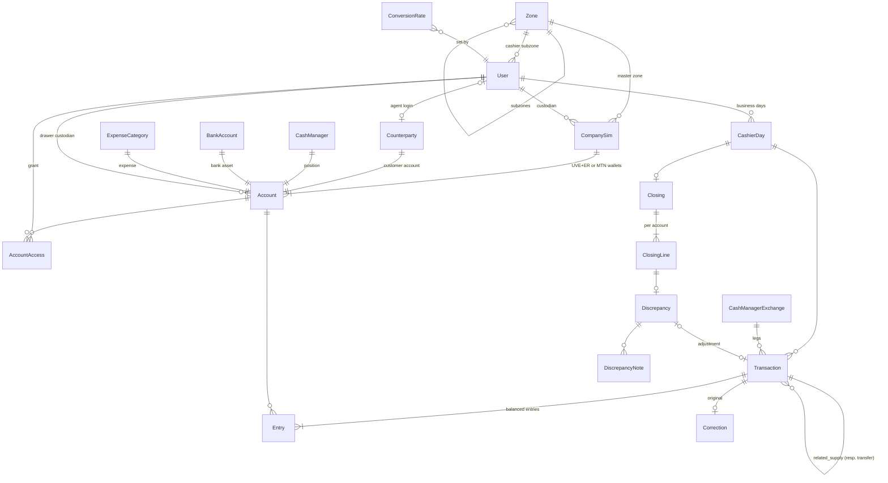

# Cashier Manager — design

Orange Cameroon distribution partner · FCFA (XAF) · Africa/Douala business dates · English/French.

## 1. Requirements consolidated

| Area | Rule as implemented |
|---|---|
| Scope | Company ↔ commercial agent and exceptional company ↔ POS transactions only. No end-user sales, agent stock, agent→POS deliveries or routes. |
| Assets | Cash per drawer; UVE and ER as two wallets of each Orange business SIM; MTN float per MTN SIM; company bank accounts (for confirmed bank deposits). |
| Customer identity | Business SIM number (normalised to 9 digits `6XXXXXXXX`, unique). Internal integer primary keys everywhere. |
| Customer balance | One combined amount per agent/POS, shared by all cashiers. UVE/ER/cash supply totals are reported separately; payments are never allocated to products. Negative balance = "supply due to customer". |
| Confirmed only | No pending / recipient-confirmation workflow. Duplicate prevention and atomic posting are technical safeguards only. |
| 1:1 | Supplies, payments, cash-manager exchanges are 1:1, no fees, no commissions. Only UVE→ER conversion has an uplift (stored rate). |
| Destockage | Drawer cash ↓, agent debt ↑, company UVE unchanged, POS recorded but owes nothing. Later UVE repayment is an ordinary UVE collection. |
| Direct POS supply | POS owes unless the cashier explicitly assigns an agent at entry. Responsibility can later move in full. |
| Expenses | Drawer cash ↓; categories configurable; Orange pre-finance is just a category; never touches agent debt. |
| Corrections | Managers/finance managers only; reversal + optional replacement; original stamped CORRECTED; nothing edited or deleted. |
| Closing | Per cashier; actual cash/UVE/ER/MTN vs expected; next entries go to next business day; differences stay open until a manager/finance manager resolves them. |

### Inconsistencies found and how they were resolved

1. *"Each cashier has one Orange SIM" vs "ER must leave from the zone master SIM"* — Fako 2's own SIM is not a master, so Fako 2 could never supply ER. Resolved by explicit **account grants**: the super administrator grants Fako 2 use of the Fako master ER wallet. Entry permission never implies wallet access (requirement §3).
2. *"Closing balances become next opening balances"* vs *"do not absorb differences"* — see decision 2.
3. *Responsibility transfer of a single supply* vs *cumulative running accounts* — see decision 1.
4. *Bank deposits* are a payment method but no bank asset was listed — bank accounts are modelled as company asset accounts (not counted at cashier closing).

## 2. Open accounting decisions (defaults built; please confirm)

| # | Question | Default implemented | Where |
|---|---|---|---|
| 1 | Responsibility transfer after part of a POS's debt was paid | Always moves the **full supply amount**; **refused** if the current party owes less than that amount, so settled debt never moves. | `operations.transfer_responsibility` |
| 2 | Carry-forward when closing shows a difference | **Book (expected) balance carries forward.** Difference becomes an open Discrepancy; later closings show it as "carried unresolved" and only a *change* creates a new discrepancy. | `services/closing.py` |
| 3 | Shared master wallet reconciliation | **Confirmed by the owner:** the master SIM is assigned to one **cashier in charge**; only that cashier uses it and it is counted in that cashier's subzone closing. All other accounts belong to a zone, not to a cashier. | `CompanySim.custodian`, `zone_closing_accounts` |
| 4 | "Corresponding master zone" for ER | Master zone of the **cashier entering** the supply. | `build_supply` |
| 5 | UVE→ER conversion destination | **Same Orange SIM**. ER = UVE × (1 + rate), **ROUND_HALF_UP to whole FCFA** (12 345 → 12 839). ER is not moved by internal transfer. | `build_conversion`, `money.py` |
| 6 | Who enters what | Cashiers enter all operations; managers/finance correct, resolve, transfer responsibility; only the super admin enters opening balances and rates. | `services/permissions.py` |

### Cash managers, wallets and openings (28/10/2026)

- **Cash-manager exchanges have no direction**: on any exchange the company may give cash or UVE and receive cash or UVE (1:1). Exchanges recorded earlier keep their direction label.
- **Accounts › Add** creates cash drawers, **UVE wallets** and **MTN float wallets** for a subzone (a UVE or MTN account is created through its SIM, so the SIM number is asked). The master SIM (ER) is added in Company sims: it belongs to the master zone (e.g. Fako, covering Fako 1 and Fako 2) and is operated by its cashier in charge.
- **Opening balances** are entered on a grid of the control accounts — cash, UVE and ER — by master zone and subzone/master SIM, with totals per column, per zone and the **total opening**. All typed amounts are posted together (all or nothing, idempotent). Agents/POS, cash managers, MTN float and banks are still entered one at a time below the grid.
- **Expenses** can be settled from a cash drawer, a UVE wallet or an MTN float wallet.
- **Agent/POS pickers** (supply, payment, destockage, responsibility transfer) lead with the **microzone**, then the name, SIM and subzone, and search by microzone, name or SIM — agents can be moved, the microzone stays.
- **Debt by product**: agent/POS openings can be split into UVE, Cash and ER (the total is their sum), and a payment can say which debt it settles (UVE / Cash / ER parts adding up to the amount). Supplies carry their product; responsibility transfers and corrections follow the original. The "Debt by product" report and each statement show what is owed per product; anything recorded without parts appears as "Not split", so the columns always add up to the single combined balance.
- **Automatic accounts**: when the subzone has exactly one matching account, it is chosen automatically and shown as a line, not a list — payments go to the account of the payment method (cash → drawer, UVE → UVE wallet, MTN → MTN float, bank → the bank when there is one), supplies leave from the wallet of the product, and any single-choice account list fills itself. The server applies the same rule if the field arrives empty; a list appears only when there is a real choice.
- **New cash-manager exchange** is one form: cash manager/bank, ref number, amount, the account the company gives from and the amount given now (default: the full amount), the date and amount served, the account served into, and a comment. It records the agreement and both legs at once; if only part is served (e.g. 8M of 10M) the **balance to be served** stays open on the exchange and is recorded later from the exchange page. Lists and the cash-manager report show the ref number, amount served and balance to be served.
- **Internal transfers** are only between MTN float, UVE or bank accounts, and only between two accounts of the same kind (MTN→MTN, UVE→UVE, bank→bank). Cash drawers and ER wallets are not transferred internally. The destination list follows the source's kind.
- Entry forms say when a subzone has no account of the needed kind yet, and who adds it.

### Company profile (multi-partner installations)

The application is not tied to one distribution partner. Each installation has one **company profile** (Administration › Company profile, super administrator only): name, optional tagline, address, city, phone, email, NIU, RCCM, receipt footer and logo. The logo is validated (PNG/JPEG/WEBP/GIF, ≤ 3 MB), trimmed, resized to ≤ 600 px and stored as PNG **in the database**, so it survives redeploys on hosts with an ephemeral disk. It appears in the menu, login page, browser tab, HTML/PDF receipts and PDF/Excel reports. The optional `COMPANY_NAME` / `COMPANY_ADDRESS` settings only pre-fill a new installation.

## 3. Stack

Django 5.2 + PostgreSQL 16. Chosen for: mature migrations, built-in authentication (salted PBKDF2 hashing), CSRF protection, server-rendered EN/FR i18n, an admin for configuration, and PostgreSQL row locks, partial unique indexes and constraint triggers for ledger safety. ReportLab (A4 PDFs), openpyxl (Excel). No JavaScript framework: forms work on low-end phones; small inline scripts only filter options.

## 4. Schema and relationships

Key constraints (all in migrations):

* `Counterparty.business_sim` unique (normalised); `CompanySim.msisdn` unique.
* One master SIM per master zone (partial unique index); only Orange SIMs can be master.
* One UVE/ER/MTN wallet per SIM; singleton system accounts; check constraints tying each account kind to its owner.
* One OPEN `CashierDay` per cashier (partial unique); one day per cashier per date.
* `Transaction.amount > 0`; `idempotency_key` unique; `reference` and `receipt_no` unique (PostgreSQL sequences); one opening balance per account; reversal must reference its original; bank collections need a reference.
* `Entry.amount ≠ 0`; indexes on `(account, business_date)` and `(account, id)`.
* **Triggers:** transactions and entries are append-only (UPDATE/DELETE raise); a deferred constraint trigger rejects any transaction whose entries do not sum to zero; another rejects any company asset account going negative.
* Money: `NUMERIC(18,0)` + Python `Decimal`; floats rejected by `to_money`.

## 5. Posting matrix (Dr = +, Cr = −)

| Type | Debit | Credit | Notes |
|---|---|---|---|
| Supply UVE | Customer (responsible) | UVE wallet (any Orange SIM the cashier may use) | receipt |
| Supply ER | Customer | ER wallet of the cashier's master-zone **master SIM** | receipt |
| Supply cash | Customer | Cash drawer | receipt |
| Destockage | Customer (**agent**) | Cash drawer | POS stored as `counterparty_2`; no POS debt; company UVE unchanged; receipt |
| Collection cash / UVE / MTN / bank | Drawer / UVE / MTN / bank | Customer (payer) | receipt; bank reference unique per bank |
| Responsibility transfer | Customer (new) | Customer (old) | full supply amount; no asset entry |
| Cash manager – company gives | Cash-manager position | Drawer or UVE (per direction) | posted only when it happens |
| Cash manager – company receives | Drawer or UVE | Cash-manager position | |
| UVE→ER conversion | ER wallet (UVE×(1+r)) | UVE wallet (UVE); Conversion uplift (UVE×r) | rate stored on the transaction |
| Expense | Expense category | Cash drawer | |
| Internal transfer | Destination asset | Source asset | same kind, or drawer↔bank; ER only within one master zone |
| Opening balance | Target account (±) | Opening equity | once per account |
| Reconciliation adjustment | Shortage: Recon adj. / Surplus: asset | Shortage: asset / Surplus: Recon adj. | only via discrepancy resolution |
| Reversal | exact negation of original | | correction |

Checks against the requirement examples (all are automated tests): supply 100 000 UVE → debt +100 000, UVE −100 000; collect 60 000 cash → debt −60 000, drawer +60 000; collect 40 000 MTN → debt −40 000, MTN +40 000; destockage 100 000 → drawer −100 000, agent +100 000, UVE 0, POS 0; then UVE payment 100 000 → UVE +100 000, agent 0 (one destockage, no supply: no double count); owes 100 000, pays 120 000 → balance −20 000 shown as supply due, payment kept at 120 000; 100 000 UVE converted → 104 000 ER.

Supplies are **not revenue**: they only move value from a company asset to a customer receivable. Revenue-like conversion uplift, expenses, cash-manager positions and reconciliation adjustments each have their own account class.

## 6. Role matrix (enforced server-side in services *and* views)

| Action | Super admin | Senior manager | Junior manager (own master zone only) | Finance mgr | Cashier | Agent |
|---|---|---|---|---|---|---|
| Configure zones, SIMs, drawers, users, grants, categories (add / edit / delete) | ✔ | |  | | | |
| Change conversion rate, opening balances | ✔ | |  | | | |
| Record supplies, destockage, payments, expenses, transfers, conversions, exchanges | ✔ (for a chosen cashier) | |  | | ✔ (accounts of own subzone; master SIM only if in charge) | |
| Register agent/POS | ✔ | ✔ | ✔ | ✔ | ✔ | |
| Responsibility transfer | ✔ | ✔ | ✔ (own zone) | ✔ | ✔ | |
| Corrections (reverse + replace, keeps history) | ✔ | ✔ | ✔ (own zone) | ✔ | | |
| **Hard edit in place / delete a transaction** | ✔ | |  | | | |
| **Clear data** (transactions, or everything) | ✔ | |  | | | |
| **Import CSV / Excel** (agents, POS, cash managers, opening balances, transactions) | ✔ | |  | | | |
| Audit log | ✔ | |  | | | |
| Close the subzone day | | |  | | ✔ | |
| Resolve discrepancies | ✔ | ✔ | ✔ (own zone) | ✔ | | |
| Reports | all zones | all zones | own zone, no company total | all zones + company reconciliation | own subzone + shared customer balances | own statement only |

### Super-administrator overrides (added at the owner's request)

The ledger tables stay append-only for everyone. The only exception is the super-administrator service (`core/services/admin.py`), which opens the database lock with `SET LOCAL core.admin_override` for one database transaction. Even then:
- a transaction is deleted or edited as a whole, so the ledger stays balanced;
- drawers, wallets and banks cannot go negative;
- the full before/after state is written to the audit log.

Editing a transaction of a day that is already closed changes that day's book balance, so the stored closing comparison no longer matches. Use corrections whenever history must be preserved.

Every transaction stores its **recording cashier** (`Transaction.cashier`), and every user has a **staff ID** (e.g. `CSH-0004`). Both are shown in lists, receipts, statements and exports. When the super admin records for a cashier, the cashier is the recording cashier and the super admin is kept as `entered_by`.

### Zones (owner's rules)

- A **master zone** (e.g. Fako) groups **subzones** (Fako 1, Fako 2). Subzones depend on their master: reports, dashboards and reconciliation roll subzones up into the master, and the master into the company.
- **Accounts are general, not a cashier's**: drawers and SIM wallets belong to a zone (`Account.zone`). Every cashier of a subzone uses that subzone's accounts. The only exception is the **master SIM**, which is assigned to its **cashier in charge**.
- **Entries are separated by zone**: every transaction stores its subzone (`Transaction.zone`) and its recording cashier.
- **Microzones**: every subzone is divided into microzones (`MicroZone`), each controlled by one **commercial agent**. A POS belongs to a microzone, so its agent in charge is known; an agent is registered with the microzone he controls (a new microzone can be created from the registration form). Microzones are shown on the agents list, filters and customer reports.
- **Senior manager** sees everything. **Junior manager** is assigned one master zone and sees, corrects and resolves only inside it (dashboard, transactions, closings, differences, reports); other zones return 404.
- **Finance manager** sees the reconciliation for each zone and the global **company** reconciliation (zone table with COMPANY TOTAL, then company assets).

## 7. Closing rules

1. Every entry belongs to its subzone's single OPEN business day, shared by all cashiers of the subzone (`posted_at` keeps the real timestamp).
2. Closing is done **per subzone** by any of its cashiers: it locks the subzone's accounts plus the master SIM of a cashier in charge in that subzone, computes expected = ledger balance, records actual, difference, carried-unresolved and new difference, closes the day and immediately opens the next business date (`max(today, previous + 1)`).
3. Closing is a blind count: expected values are shown after submission.
4. No movement is invented. Only a manager/finance manager resolution can post a reconciliation adjustment, linked to the discrepancy with notes, user and date. Alternatives: link a correction, or record a counting error (no posting).
5. Weekly/monthly/custom/overall reports are views over the same ledger; nothing needs approval.

## 8. Correction rules

1. Allowed for managers/finance managers on supplies, destockage, collections, expenses, transfers, conversions, cash-manager legs and opening balances; responsibility transfers can only be cancelled.
2. Posts a reversal (and optional replacement re-validated with the original cashier's permissions and zone; conversions keep their original rate) in one database transaction; overspending is checked on the net effect.
3. Posted on the **current open day of the original cashier**, with `original_business_date`. Established closings are never rewritten; the closing page lists corrections posted later for that day, and the next closing absorbs them as movements.
4. A supply whose responsibility was transferred must have the transfer cancelled first, so customer balances stay consistent.
