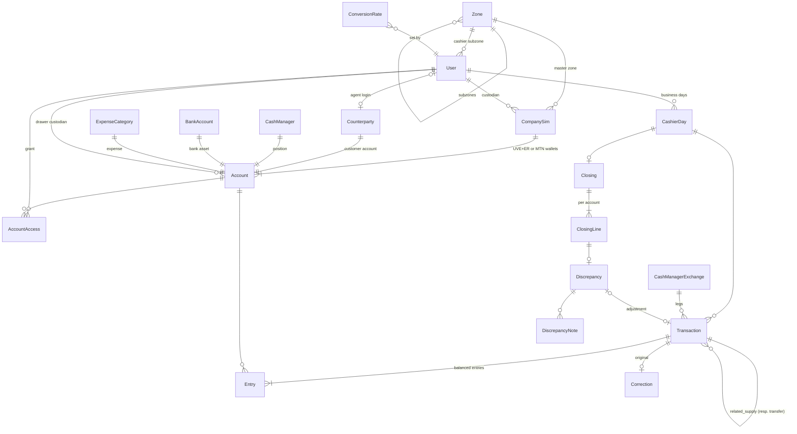

# Cashier Manager — design

Orange Cameroon distribution partner · FCFA (XAF) · Africa/Douala business dates · English/French.

## 1. Requirements consolidated

| Area | Rule as implemented |
|---|---|
| Scope | Company ↔ commercial agent and exceptional company ↔ POS transactions only. No end-user sales, agent stock, agent→POS deliveries or routes. |
| Assets | Cash per drawer; UVE and ER as two wallets of each Orange business SIM; MTN float per MTN SIM; company bank accounts (for confirmed bank deposits). |
| Customer identity | Business SIM number (normalised to 9 digits `6XXXXXXXX`, unique). Internal integer primary keys everywhere. |
| Customer balance | One combined amount per agent/POS, shared by all cashiers. UVE/ER/cash supply totals are reported separately; payments are never allocated to products. Negative balance = "supply due to customer". |
| Confirmed only | No pending / recipient-confirmation workflow. Duplicate prevention and atomic posting are technical safeguards only. |
| 1:1 | Supplies, payments, cash-manager exchanges are 1:1, no fees, no commissions. Only UVE→ER conversion has an uplift (stored rate). |
| Destockage | Drawer cash ↓, agent debt ↑, company UVE unchanged, POS recorded but owes nothing. Later UVE repayment is an ordinary UVE collection. |
| Direct POS supply | POS owes unless the cashier explicitly assigns an agent at entry. Responsibility can later move in full. |
| Expenses | Drawer cash ↓; categories configurable; Orange pre-finance is just a category; never touches agent debt. |
| Corrections | Managers/finance managers only; reversal + optional replacement; original stamped CORRECTED; nothing edited or deleted. |
| Closing | Per cashier; actual cash/UVE/ER/MTN vs expected; next entries go to next business day; differences stay open until a manager/finance manager resolves them. |

### Inconsistencies found and how they were resolved

1. *"Each cashier has one Orange SIM" vs "ER must leave from the zone master SIM"* — Fako 2's own SIM is not a master, so Fako 2 could never supply ER. Resolved by explicit **account grants**: the super administrator grants Fako 2 use of the Fako master ER wallet. Entry permission never implies wallet access (requirement §3).
2. *"Closing balances become next opening balances"* vs *"do not absorb differences"* — see decision 2.
3. *Responsibility transfer of a single supply* vs *cumulative running accounts* — see decision 1.
4. *Bank deposits* are a payment method but no bank asset was listed — bank accounts are modelled as company asset accounts (not counted at cashier closing).

## 2. Open accounting decisions (defaults built; please confirm)

| # | Question | Default implemented | Where |
|---|---|---|---|
| 1 | Responsibility transfer after part of a POS's debt was paid | Always moves the **full supply amount**; **refused** if the current party owes less than that amount, so settled debt never moves. | `operations.transfer_responsibility` |
| 2 | Carry-forward when closing shows a difference | **Book (expected) balance carries forward.** Difference becomes an open Discrepancy; later closings show it as "carried unresolved" and only a *change* creates a new discrepancy. | `services/closing.py` |
| 3 | Shared master wallet reconciliation | **Confirmed by the owner:** the master SIM is assigned to one **cashier in charge**; only that cashier uses it and it is counted in that cashier's subzone closing. All other accounts belong to a zone, not to a cashier. | `CompanySim.custodian`, `zone_closing_accounts` |
| 4 | "Corresponding master zone" for ER | Master zone of the **cashier entering** the supply. | `build_supply` |
| 5 | UVE→ER conversion destination | **Same Orange SIM**. ER = UVE × (1 + rate), **ROUND_HALF_UP to whole FCFA** (12 345 → 12 839). ER is not moved by internal transfer. | `build_conversion`, `money.py` |
| 6 | Who enters what | Cashiers enter all operations; managers/finance correct, resolve, transfer responsibility; only the super admin enters opening balances and rates. | `services/permissions.py` |

### Cash managers, wallets and openings (28/10/2026)

- Cash-manager exchanges are 1:1: cash or MTN float against UVE, or UVE against cash (see below). Older exchanges recorded without a direction accept cash or UVE on either side.
- **Accounts › Add** creates cash drawers, **UVE wallets** and **MTN float wallets** for a subzone (a UVE or MTN account is created through its SIM, so the SIM number is asked). The master SIM (ER) is added in Company sims: it belongs to the master zone (e.g. Fako, covering Fako 1 and Fako 2) and is operated by its cashier in charge.
- **Opening balances** are entered on a grid of the control accounts — cash, UVE and ER — by master zone and subzone/master SIM, with totals per column, per zone and the **total opening**. All typed amounts are posted together (all or nothing, idempotent). Agents/POS, cash managers, MTN float and banks are still entered one at a time below the grid.
- **Expenses** can be settled from a cash drawer, a UVE wallet or an MTN float wallet.
- **Agent/POS pickers** (supply, payment, destockage, responsibility transfer) lead with the **microzone**, then the name, SIM and subzone, and search by microzone, name or SIM — agents can be moved, the microzone stays.
- **Payments with several methods**: the payment form has one amount per method — Cash, UVE, MTN float, Bank deposit (with reference; bank account chosen automatically when there is one) — and shows the total. Each method is posted as its own collection into the subzone's account for that method, all together (all or nothing), sharing a payment group and **one receipt** that lists every part and the total. Reports by method keep working, and a mistaken part can be corrected on its own.
- **Supplies with several products**: Supply to agent and Supply to POS have one amount per product — Cash, UVE, ER — and show the total. Cash leaves the subzone's drawer, UVE its UVE wallet and ER the master SIM of the master zone (cashier in charge only), automatically. Each product is its own supply (so the supply reports by product keep working), posted together with one group and **one receipt** listing every part and the total.
- **One combined debt**: an agent or POS has a single combined balance. Payments and agent/POS opening balances are one amount, not split into UVE, Cash or ER (supplies still record their product for the supply reports).
- **Automatic accounts**: when the subzone has exactly one matching account, it is chosen automatically and shown as a line, not a list — payments go to the account of the payment method (cash → drawer, UVE → UVE wallet, MTN → MTN float, bank → the bank when there is one), supplies leave from the wallet of the product, and any single-choice account list fills itself. The server applies the same rule if the field arrives empty; a list appears only when there is a real choice.
- **Exchange sides are automatic**: the cashier picks what the company gives — cash or MTN float (then it is served UVE) or UVE (then it is served cash). The give and served-into accounts are the subzone's accounts of those kinds, filled in automatically; later legs on the exchange page follow the same rule.
- **New cash-manager exchange** is one form: cash manager/bank, ref number, amount, the account the company gives from and the amount given now (default: the full amount), the date and amount served, the account served into, and a comment. It records the agreement and both legs at once; if only part is served (e.g. 8M of 10M) the **balance to be served** stays open on the exchange and is recorded later from the exchange page. Lists and the cash-manager report show the ref number, amount served and balance to be served.
- **Internal transfers** are only between MTN float, UVE or bank accounts, and only between two accounts of the same kind (MTN→MTN, UVE→UVE, bank→bank). Cash drawers and ER wallets are not transferred internally. The destination list follows the source's kind.
- Entry forms say when a subzone has no account of the needed kind yet, and who adds it.

### Shops (points of service)

Shops are separate from the cashiers' desks. Each shop (Configuration › Shops) has its own **cash drawer, UVE and ER** accounts (created automatically; its company SIM number is recorded on the shop), its **shop manager** (teller and controller of that shop) and the one **senior shop manager** over all shops. Finance, the senior manager and the super administrator see every shop (Shops overview: capital and activity per shop with totals; shop transactions; SIM retrievals; services count; stock). Shops never see the commercial agents' balances (the agent picker shows names only), the cashiers' transactions or reports; cashiers and junior managers do not see shop dealings.

Shop operations go through the same double-entry ledger, on the shop's accounts (`Transaction.shop`, no cashier or business day):

| Operation | Effect |
|---|---|
| Orange Money cash-in | UVE −, cash + (commission recorded, not posted) |
| Orange Money cash-out | UVE +, cash − (commission recorded) |
| Airtime sale (**normal** or **good deal**, stored as the subtype) | ER −, cash + |
| UVE→ER conversion | at the **shop rate** (separate from the cashiers' rate; set by the super admin on the main Conversion rate page — Shops' rate section — or by the senior shop manager in shop setup) |
| Appro (UVE from an agent) | UVE +; cash −, or owed to the agent if on credit |
| ER supply from an agent | ER +; cash − or UVE −, or owed to the agent if on credit |
| Destockage with an agent | UVE −; cash +, or **the agent owes the shop** if on credit |
| Agent pays the shop | the agent's debt to the shop −; cash + or UVE + |
| Pay an agent | owed to the agent −; cash − or UVE − |
| Transfer to a cashier (**UVE only**) | shop UVE −; the cashier's UVE wallet + — posted in that subzone's business day, so it shows on the cashier side too |
| Cashier: transfer to a shop | the cashier's UVE wallet −; shop UVE + (recorded by the cashier, visible to both sides) |
| Item sale | cash +, shop sales −; the chosen units (by IMEI / serial) become SOLD |

Counted services (OTT, MAX IT, identification update, ticket creation, … — added or removed by the senior shop manager / super admin) record only their number per day. A **SIM retrieval** registers the SIM, the new SIM serial, the person's name, ID type and number and contact. Items belong to **categories** (managed in shop setup) and have a price. Stock is kept **unit by unit with an IMEI / serial number** (`StockUnit`: in stock / sold / removed, each number registered once); a sale picks category → item → units and records the **client's full name, address, country of origin, identification type (national ID, passport, residence permit, receipt, other) and number, telephone and WhatsApp** (`ItemSale`), all shown on the receipt. Stock counted before serials were introduced must be re-entered with serials. Shop dealings with agents use a per-shop, per-agent **position** account (negative: the shop owes the agent; positive: the agent owes the shop) and never touch the agent's balance with the company. Shop accounts appear in the opening grid (Shops group) and in the finance reconciliation (SHOPS rows, included in the company total).

#### Segmented shops and shop administration (30/10/2026)
A shop can have several staff, each with **duties** (`User.shop_duties`; empty = all duties): Orange Money cash-in / cash-out · Airtime and UVE→ER conversion · Item sales and stock · Counted services and SIM retrieval · Commercial agents and transfers to cashiers. Example: one person on the Orange Money desk, another on airtime and everything else. Duties are enforced in the services (`shop_for(..., duty)`) and the pages (403), and each person's menu shows only their duties. The shop page lists every staff member with their duties and what they recorded in the period. The staff share the shop's cash drawer, UVE and ER accounts; each operation records who entered it.

The **senior shop manager** (and the super admin) has a **Shops & staff** page: add, edit (close/reopen) and delete shops; create shop staff logins (temporary password, changed at first sign-in), change their shop (transfer) and duties, reset passwords, deactivate/activate and delete accounts. In **Services, items & rate** they add, edit and delete services, categories and items. Anything with history (a shop with operations, stock or staff, a staff member who recorded something, a service/item/category already used) is never deleted: the app says so and it is deactivated instead. The senior cannot manage non-shop accounts or other senior shop managers (super admin only).

#### Shop shifts and daily reconciliation (30/10/2026)
**Shifts (attendance).** Every shop staff member opens a shift when starting work and closes it when leaving (`ShopShift`: opened/closed time, hours). Shop staff can only record (operations, services, retrievals, stock) during an open shift; the pages send them to **My shift** otherwise. One open shift per person; in a segmented shop the shifts run side by side. Whoever **takes over the till** (no other shift open) counts the cash and reads the UVE and ER balances on the shop SIM; whoever **hands it back** (last to close) counts again; the others may skip the counts. Each count is stored with the system balance at that moment, and the difference is shown (never posted). The senior shop manager can close a forgotten shift, with a reason. A staff member cannot be transferred to another shop during an open shift. **Attendance** page: days worked, shifts, hours per person, shifts still open and shifts closed by the senior; staff see only their own.

**Daily reconciliation** (per shop and business date; list of all shops per day plus a detail page): for cash, UVE and ER — system opening (end of the previous day) + money in − money out = system closing, next to the count at the first shift opening and the count at the last shift closing, with opening and closing differences; the operations of the day and how each moved cash, UVE and ER; commissions; services done; the day's shifts. Status: shift(s) still open · no closing count · difference · balanced. The senior shop manager **signs off** the day (`ShopDayReview`); a difference must be explained, and a day cannot be signed off while shifts are open. Finance, the senior manager and the super admin see all shops; staff see their own shop.

#### Cashiers and shops as two workspaces; services in one record (30/10/2026)
Finance, the senior manager and the super administrator switch between two **workspaces** at the top of the menu: **Cashiers** (home, agents & POS, transactions, cash managers, closings, differences, reports) and **Shops** (overview, transactions, retrievals, services, daily reconciliation, attendance, stock, setup). Each workspace shows only its own menu; shared pages (a receipt, passwords, administration) keep the last workspace. The cashiers' reports no longer include the shop accounts: the reconciliation by zone ends with **CASHIERS TOTAL**, and the only shop-related column there is "Transfers with shops" (UVE moved between a cashier and a shop). The shops' figures live in the Shops overview and the shops' daily reconciliation.

**Services done**: one form lists every active counted service with its own count box; the staff type how many of each were done and record them together (`count_services`, one `ServiceCount` per service with a count, in one transaction). The page also shows what was already recorded today.

#### Capital, shop reports and multi-item sales (30/10/2026)
**Capital** (finance manager, senior manager, super admin; menu "Capital" in both workspaces). Three movements, each with a description, the **source of the funds** (or, for a withdrawal, who / where it goes to) and the **purpose**:
* **Inject** — Dr the chosen company account (any cash drawer, UVE, ER, MTN float, bank or shop account) / Cr **Owner's capital** (new system account).
* **Withdraw** — Dr Owner's capital / Cr the account (balance checked).
* **Transfer** — Dr the receiving account / Cr the sending account, between any two company accounts (cashier subzones, master SIMs, banks, shops); same product, or cash ↔ bank.
A movement on a cashier-side account is posted in that subzone's open business day (the cashier sees it, the closing counts it); a shop account sets the shop on the entry (the shop sees it; its reconciliation and reports count it). The cashiers' reconciliation report has a "Capital movements" column so opening + movements = closing still holds. Capital movements can only be cancelled (reversal) and recorded again. The Capital page shows net capital (all time), injected, withdrawn, transferred and the list of movements.

**Shop reports** (Shops workspace › Shop reports; on screen, Excel, PDF): **Daily** (the day, by shop), **Weekly** (Monday–Sunday, by day and by shop), **Monthly** (by week and by shop), **Custom** dates (by day and by shop); all shops or one. Two tables per breakdown: *activity* (cash-in/out with counts, commission, airtime and good deal, conversions, item sales and units, services, SIM retrievals, staff hours) and *agents, cash control and balances* (appro, ER supply, destockage, paid to / by agents, UVE to / from cashiers, net capital, counted closing differences, closing cash/UVE/ER at the end of each line), plus services by type and summary tiles.

**Sales of several items**: one sale to one client can contain any number of units of any items. The page lists everything in stock by category and item (filter + search by item or IMEI/serial); the cashier ticks the units, the basket shows each item with its quantity, an editable unit price and the total; the client's details are entered once. Each item is posted as its own sale line, all lines sharing one group and **one receipt** that lists every item with its serials and the total.

#### Cash managers, report sections, duty-based views (30/10/2026)
**Cash managers** — the finance manager (and the super admin) add, edit (name, phone/SIM, notes, active) and delete cash managers on the Cash managers page. One with exchanges cannot be deleted (its account has entries): untick Active instead; inactive ones disappear from the exchange form.

**Shop report** now also has a **SIM retrievals** table (date, shop, SIM, new ICCID, person, ID, phone, recorded by) and an **Attendance summary** (per staff: duties, days worked, shifts, hours, still open, closed by the senior), plus a SIM retrievals tile and a staff-hours tile.

**Duty-based views** — a staff member who does not have every duty sees only what belongs to their duties, everywhere: transaction detail (404 otherwise), shop transactions list and its type filter, the shop page (activity, recent operations; agent positions only with the agents duty; services only with the services duty; no staff table), SIM retrievals and services pages (services duty), stock (sales duty), the daily reconciliation (their operations and their own shifts; the till balances stay visible) and the shop report (only the columns, tiles and tables of their duties, their own hours and attendance; "Your duties only" is shown). Capital and opening entries are only for staff with every duty. Operation → duty: cash-in/out → Orange Money; airtime, UVE→ER → Airtime; item sale → Sales; appro, ER supply, destockage, payments with agents, UVE to/from cashiers → Agents.

#### Optional cash manager SIM; admin tools cover the shops (30/10/2026)
* A cash manager's phone / SIM number is optional (several may have none; one given is still unique). Import matches a cash manager by SIM, or by name when no SIM; opening import accepts the name too.
* **Clear data** (super admin) has three scopes: **Shops only** (every entry with a shop or on a shop account — shop operations, transfers between shops and cashiers, capital on shops, with their corrections — plus shifts, day sign-offs, stock units and sales, services and SIM retrievals; shops, staff, items and the cashiers' data stay), **All transactions** (cashiers and shops, plus the same shop records) and **Everything** (also agents, POS, agent logins, cash managers and the shops' positions with agents). Deleting a single sale puts its units back in stock.
* **Import CSV / Excel** gains: **Shops** (code, name, zone, SIM, address, active), **Shop staff** (username, names, shop, duties or ALL, temporary password — changed at first sign-in), **Shop items** (category created if new, name, price), **Shop stock** (shop, item, IMEI/serials), **Shop transactions** (date, shop, CASHIN / CASHOUT with commission, AIRTIME / GOOD_DEAL, CONVERT, SERVICE count), and shop opening balances (SHOP_CASH / SHOP_UVE / SHOP_ER + shop code). Templates for each are downloadable; the dry run checks every row before anything is posted.

#### Shop opening balances (30/10/2026)
Shops have their own **Shop opening balances** page (Shops workspace; super administrator, like the cashiers' page): a grid with one line per shop (cash drawer, UVE, ER) with live totals, recorded together for a go-live date; and the shops' **positions with commercial agents** (the agent owes the shop, or the shop owes the agent), one at a time on the shop–agent position account (`SHOP_PAYABLE` is now an opening kind; never touches the agent's balance with the company). Each account opens once (later changes go through a correction). Shop openings carry the shop, so the shop sees them (staff with every duty); the cashiers' opening page no longer lists shop accounts.

#### Stock received unit by unit; Admin tab (30/10/2026)
**Receiving stock**: the form asks for the **number of units received**; one line per unit then appears with an **IMEI** box (15 digits) and a **serial number** box — at least one per unit, both allowed (`StockUnit.imei` and `StockUnit.serial`, each unique when given). Duplicates in the batch, numbers already registered and malformed IMEIs are refused and the lines come back with what was typed; a barcode scanner's Enter jumps to the next box. Units show as "IMEI … · S/N …" in the sale picker, stock list, receipts and search; a unit is removed by its IMEI or serial number. The stock import treats a 15-digit number as an IMEI, anything else as a serial number.

**Admin tab**: the super administrator has a third tab, **Admin**, next to Cashiers and Shops. It holds all administration, grouped: Admin tools; Settings (users & passwords, company profile, conversion rate, configuration); Opening balances (cashiers', shops'); Shops setup (shops & staff, services, items & rate); Capital; Data (import, audit log, clear data). The Cashiers and Shops menus keep only the daily work. Finance and the senior manager keep two tabs and their Capital link; the senior shop manager keeps Shops & staff and Services, items & rate in the shop menu.

#### Section downloads, shop expenses and purchases, income statement (30/10/2026)
**Downloads**: every report (cashiers' and shops') has a "Download" selector (the whole report or one section) beside the Excel / PDF buttons, and each section heading has its own Excel · PDF links (`?table=N`, `only_table()`).

**Shop expenses** (new duty "Expenses and purchases"): category (the same expense categories as the cashiers), amount, paid from the cash drawer or UVE, description — Dr the category's expense account / Cr shop cash or UVE (`SHOP_EXPENSE`).

**Shop purchases** (same duty): items bought for resale — category, item, number of units with one IMEI / serial line per unit, purchase price per unit, paid from cash or UVE, supplier, note. Dr **shop stock at cost** (`SHOP_INVENTORY`, one per shop, created on first use) / Cr cash or UVE (`SHOP_PURCHASE`); each unit keeps its cost. Selling a unit with a cost also posts Dr **cost of items sold** / Cr shop stock at cost; removing one posts Dr **stock written off** / Cr shop stock at cost (`SHOP_STOCK_OUT`). Units received without a purchase (opening stock, stock sent from head office) have no cost. The admin's single delete of a purchase takes its units out of stock (refused if one was sold).

**Income statement per shop** (Shop reports › Which report: Income statement; staff with every duty, finance, managers, admin): item sales − cost of the items sold = margin on items; + Orange Money commissions (as recorded) + UVE→ER conversion gain = total income; − expenses by category − stock written off = total costs; net result. One column per shop plus all shops; daily, weekly, monthly or custom; Excel / PDF. The activity summary also has Expenses and Purchases columns.

#### Transfers in cash and UVE with separate boxes (03/11/2026)
Transfers between desks no longer pick a product from a list; like the supply form, each has one amount box per product and a running total, and the parts are posted together (all or nothing) with one group and **one receipt** listing each part and the total:
* **Cashier → cashier** (Transfer): choose the receiving desk (subzone), then Cash, UVE and / or MTN float. Each amount leaves the cashier's own account of that kind and arrives in the other desk's account of the same kind (its own, or the master SIM wallet its cashier in charge works with). Not to one's own desk.
* **Cashier → shop** (Transfer to shop): choose the shop, then Cash and / or UVE (drawer → shop drawer, UVE wallet → shop UVE).
* **Shop → cashier** (Transfer to a cashier, agents duty): choose the cashier desk, then Cash and / or UVE; posted in that desk's business day so it shows on the cashier side and in its closing.
Shop reports' columns are now "To cashiers" / "From cashiers" (cash and UVE together).

#### Transfers for every shop staff member, shop-to-shop, account name, transfer reconciliation (04/11/2026)
* **Transfers are open to every shop staff member**, whatever their duties (e.g. the Orange Money desk): a "Transfers" menu group and two buttons on the shop page — **Transfer to a cashier** and **Transfer to another shop**. Transfer entries (to / from cashiers, between shops) are visible to all staff of the shop.
* **Shop → shop** (`SHOP_TO_SHOP`): choose the receiving shop, then Cash and / or UVE (drawer → drawer, UVE → UVE); one group, one receipt. Both shops see it (the receiving shop in its transaction list, its page — line "transfer received from another shop" — and its reports' "From other shops" column); cashiers do not.
* **Cash-in / cash-out** record the **account name** (the name on the client's Orange Money account; required in the form) next to the optional client phone; shown on the receipt and in the shop lists; importable (`account_name` column).
* **Transfer reconciliation** (replaces the "Internal transfers" report; also in Shop reports › Which report): every internal transfer — cashier ↔ cashier, cashier ↔ shop, shop ↔ shop, capital transfers — over the period: by desk / shop (sent and received per product, totals, net), who sent what to whom (pairs per product), the full list, and the check that total sent equals total received. A desk or zone filter keeps the transfers it sent or received; the shops' version keeps transfers touching the shops.

#### Shift closing with expected balances; paying back received transfers (04/11/2026)
* **Shift page**: under each count box (cash, UVE, ER) the **expected running balance** (system balance now) is shown, with the live difference as the person types ("matches" or "difference −33 000"). On **closing**, any difference makes the **note mandatory** (checked on the page and enforced by the service).
* **Paying back transfers**: every transfer between desks and shops (cashier ↔ cashier, cashier ↔ shop, shop ↔ shop) created from now on is marked *to be paid back* (`Transaction.to_settle`). The receiver sees **Pay the sender** on the transfer (and on the shift page): a payment in cash and / or UVE (MTN float too between cashiers), in one or several goes, posted as a transfer in the other direction that points to the original (`settles`) and is not itself to be paid back. The transfer page shows transferred / paid back / still owed and the payments. Only the receiver may pay, never more than what is owed.
* **Automatic note at closing**: when a shop closes a shift, the transfers it received and has not fully paid back are listed on the shift page and written automatically into the closing note ("Transfers received not paid back yet: TX… from Fako 1 on 04/11/2026: 150 000 FCFA not paid back yet").

#### Transfer payments on the cashier side (04/11/2026)
Cashiers get the same treatment as shops for transfers they receive (from another cashier or from a shop): their **home page** and **Close day** page list the transfers received and not yet paid back (sender named, still owed, total) with **Pay the sender** buttons (the payment returns to the page it was started from), and when the day is closed the ones still unpaid are written automatically into the closing notes (`Closing.notes` is now a text field). The shop page shows the same box to the shop's own staff.

### Commercial agent portal (04/11/2026)
Commercial agents (role AGENT, linked to their agent account) have a working portal. The home page is kept short: what they owe the company (and paybacks waiting), what their clients owe them, four actions and today's stock in hand.
* **Zone**: an agent's zone is his **master zone** (from his microzone). **My POS** lists every POS connected to that zone with full information; POS of his own microzones are marked "mine". A POS of another zone **can still be supplied**, by typing its number, but its page is not shown (404): the agent only ever sees its name.
* **Supply a client** (`AgentClientEntry`, kind SUPPLY): to an end-user **POS** (its business SIM), a **shop** (its SIM is picked automatically and shown) or **another client** (his phone number only, no name), with a **product** dropdown (UVE / ER / cash), one amount and **paid now** (the rest is owed to the agent). The button reads **Supply** for UVE / ER and **Record** for cash. Pressing it **records at once (fetch), clears the form and hands the Orange code to the phone's dialpad** — no extra page: UVE `#149*5*<number>*<amount>#`, ER `#189*2*<number>*<amount>#`. The message shows the code again as a link. Without JavaScript the form posts normally. **A client pays me** reduces what that client owes. These are the agent's own dealings, **not in the company ledger**; today's mistakes can be cancelled with a reason.
* **Transfer to an agent** (client kind AGENT, `to_agent`): UVE / ER / cash from the agent's stock to another commercial agent (by business SIM). It moves stock from one to the other (no debt through the portal) and dials the same codes to the other agent's number. Both see it (My transactions › Agents).
* **Pay back the company** (`AgentPayback`): to **a cashier of his zone** (UVE to the master SIM of the zone, cash or MTN float) or to **a shop** (UVE to the shop SIM, or cash). A UVE payback dials `#149*5*<master SIM or shop SIM>*<amount>#` the same way. It stays **pending** until the receiver confirms it — the cashier of that desk (home box, Agent paybacks page), or the staff of that shop during an open shift (shop page box, Agent paybacks link). A cashier's confirmation posts `record_payment` (COLLECTION, one receipt); a shop's posts `SHOP_AG_PAYBACK` (Dr shop cash / UVE, Cr the agent's account; visible to all shop staff and in the shop reports' "Paid by agents"). Either way it reduces the agent's balance like any payment. Rejecting needs a reason; the agent can withdraw a pending one.
* **Office supplies**: every SUPPLY and DESTOCKAGE the office recorded on the agent (also those delivered straight to a POS for him), with per-day totals by product.
* **Daily reconciliation** (automatic, any date): stock and cash in hand per product — opening + from the office + from agents + collected from clients (cash) − supplied − to agents − paid back = in hand; the account with the company (owed at start + office supplies / destockage − payments confirmed = owed at end); clients (owed at start + supplied − received = owed at end); the day's office supplies and operations; a 14-day summary.
* **My transactions**: tabs My clients, Agents, My paybacks, All office records (with the existing statement).

#### Agent payments by product, debtors, float exchange, targeted clear data (04/11/2026)
* **How the client pays** is recorded in three boxes — cash, UVE, MTN float (`paid_cash`, `paid_uve`, `paid_mtn`; `paid` is their total; older records count as cash). The supply form shows the boxes that fit: a **cash supply** is paid in UVE or float, a **UVE / ER supply** in cash or float. *A client pays me* has cash / UVE / float boxes with a total.
* **Stock in hand** follows that: what is supplied leaves the agent's stock (cash, UVE or ER) and what is received comes in by the way it was paid. Stock is now kept for UVE, ER, cash and **float**; paybacks in MTN float reduce float.
* **Float exchange** (`AgentExchange`, 1:1): *I send float, I receive UVE* · *I send float, I receive cash* · *I receive float, I send UVE* (the other party's number is required and the UVE code is dialled to it). Shown in the daily reconciliation as "Float exchanges"; today's can be cancelled.
* **My debtors**: every client with a balance, the amount outstanding, his number and last supply, a **Receive payment** button (opens *A client pays me* for that client) and **Remind** (an SMS with the amount owed, on the phone).
* **Clear data** has two more scopes: **commercial agents' records only** (supplies, client payments, transfers, exchanges, paybacks — for one agent or all; company ledger entries such as office supplies and confirmed payments stay), and **one user's records** (transactions he entered or that belong to his desk, with their corrections, his shifts, services and SIM retrievals, and for an agent his portal records; balances are re-checked and nothing is removed if an account would go negative).

#### Float in the cashiers' openings, shared float accounts, shops' UVE with POS, cashiers' daily reports (04/11/2026)
* **Opening balances**: the cashiers' grid now has an **MTN float** column next to cash, UVE and ER (the shops' grid keeps cash, UVE, ER).
* **Accounts used by all cashiers** (`Account.shared`, Configuration › Accounts: "used by all cashiers"): e.g. a company MTN float SIM. Every cashier, whatever the subzone, can receive payments into it and use it; it is counted at the closing of the subzone set on the account (the one that keeps the SIM). A desk's own account stays the default; on the payment form, when a cashier has his own float SIM and a shared one, **Float received on** asks which.
* **Shop cash-in / cash-out**: the account name is optional.
* **Shops and POS** (staff with the agents duty): **Send UVE to a POS** — shop UVE down; the POS pays cash now (drawer up) or **on credit** (the POS's account with the company goes up, like a direct POS supply) — and **Receive UVE from a POS** — shop UVE up; the shop pays cash now, or it settles what the POS owes (`SHOP_POS_UVE_OUT` / `SHOP_POS_UVE_IN`).
* **Cashiers' daily reports** (Reports; cashiers see their own desk, supervisors their scope; on screen, Excel, PDF):
  * **Daily reconciliation** — each day, for cash, UVE, ER and MTN float: opening + in − out = closing (book), what was counted at that day's closing and the difference, "closed / not closed".
  * **Daily supplies versus payments** — a pivot: *Supplied · <each cashier's desk>* (supplies and destockage) · *Float supplied (finance)* (float converted and sent to an agent) · *Total supplied* · *Paid · <each cashier's desk>* (cash, UVE, bank) · *Paid in float* · *Total paid* · *Balance for the period (+ owes, − overpaid)* · *Total balance today, all desks (+ owes, − credit)*. The summary at the top repeats every column and ends with the total balance today. Tables: **Summary by subzone** (one line per subzone, number of agents / POS, total); **Per agent / POS, by subzone** (subzone heading, its agents and POS, the subzone total, the grand total — an agent running several microzones / distribution roads is listed once, under the subzone of his own microzone, with all his microzones); **Day by day**; **Per cashier / finance** by product (UVE, ER, cash, destockage, float) and payment method. Subtotal rows are bold and not counted twice (engine `_sub` / `_head` rows, on screen, PDF and Excel; PDF amounts right-aligned). A cashier sees his own desk, including float supplied from his desk's float account.
  * **Pivot layout in every report** — shared helpers in `core/reports/defs.py`: `zone_pivot` (master-zone heading → one line per cashier's desk → master-zone subtotal → grand total; one column per category plus Total / Count), `pivot_summary` (summary tiles from the grand totals) and `group_by_subzone` (agents / POS under their subzone with a subtotal; an agent with several microzones listed once). Applied to: **Supplies** (UVE / ER / cash / float / destockage by zone and cashier, then agents versus POS by product), **Collections** (one column per payment method), **Destockage** (count and amount), **Expenses** (one column per category), **Conversions** (UVE converted, ER received, uplift), **Agent and POS balances**, **POS** and **Supply due** (grouped by subzone, compact columns: agent / POS · SIM, microzones, opening, supplied, paid, transfers / corrections, closing, balance now), **Statement** (supplied by product and paid by method, with totals), **Accounts** (grouped by master zone / shop / company with subtotals; tiles per account type and total balance now), **Transfers** (by desk and shop grouped as cashier desks / shops / company, with subtotals), **Closings** (grouped by subzone with difference subtotals; tiles), **Cash managers** and **Corrections** (summary tiles). Detail tables stay below the pivots. Every list is a pivot too: engine `group_rows(rows, cols, key, …)` adds a heading line per group (spanning the table on screen and in the PDF) and a bold subtotal per group (grand total unchanged, subtotals not counted twice); `drop_empty_columns` hides money columns that are zero on every line. Transaction details (supplies, collections, expenses, POS, destockage, conversions, cash-manager legs, responsibility transfers) are grouped **by cashier's desk** (heading "Fako 1 · cashier (ID)", so the cashier columns are dropped); the statement by business day; account movements by account; transfers by sender; corrections by kind; cash-manager agreements by cash manager; unresolved differences by subzone; daily reconciliation by day. **Reconciliation**: the zone table has the master zone as heading with its subzones / master SIMs and its subtotal; the asset table is grouped by product (cash drawer, UVE, ER, MTN float, bank) with subtotals and shows only the movement columns that moved in the period. Shop reports: services, SIM retrievals and attendance grouped by shop.
  * **Dashboard balances by zone** — total balance tile, a Total column for each zone / subzone / master SIM, and a company total row.

#### UVE with agents and POS for every shop staff member; fewer comments (04/11/2026)
* **Send UVE / Receive UVE** (shop page buttons and the "Transfers and UVE" menu group) are open to every shop staff member, whatever their duties, with **any commercial agent or POS** (business SIM). Sending: shop UVE down, paid in cash now or on credit (their account with the company goes up). Receiving: shop UVE up, the shop pays cash now or it settles what they owe.
* **Fewer comments**: explanatory paragraphs under titles and section headings, form introductions, field hints and the line under the Record button are no longer shown (CSS in `app.css`). Lines that carry information — dates, totals, SIM numbers, links, empty-list messages, warnings before deleting or editing — are marked `.meta` and stay.

#### Admin edits any entry; supplies may go negative; agents and POS wording; paid now; "No" to a payback; payments into another desk's wallet; float for UVE (05/11/2026)
* **Super administrator**: Edit is offered on every entry, whoever recorded it. Cashier entries keep the full edit; any other entry (shops, capital, transfers, payments received by shops…) can change its amount (when it is one value between two accounts), date, note and, for cash-in / cash-out, account name and phone — balances checked, the previous values in the audit log. Delete works on every entry. The agents' portal records, services counted and SIM retrievals can be edited or deleted in Configuration.
* **Supplies may take a drawer or wallet below zero**: the balance shows negative. Every other outflow (transfers, expenses, exchanges…) still needs the money, and money coming in repairs a negative balance. Enforced in the posting service and by the database trigger (migration 0037: an outflow entry is refused when the account ends below zero unless it belongs to a supply). Admin edits/deletes only refuse a change that makes an account more negative.
* **Wording**: "customer" is gone from the interface — commercial agents and points of sale (POS) are named as such (e.g. "Agent and POS balances", "Paying agent or POS").
* **Supply with payment on the spot**: the cashiers' supply forms (to an agent, to a POS) have "Paid now in cash / UVE / MTN float"; the payment is recorded with the supply (its own receipt), by whoever owes the supply.
* **"No" beside "Pay the sender"**: the receiver of a transfer can answer No; it stays not paid back, is no longer prompted (home, closing, shift) and shows "Not paid back" with who decided (`TransferNoPayback`).
* **Payments into another desk's wallet**: on the payment form, "UVE received on" / "Float received on" list the UVE and MTN wallets of every desk (own desk by default) — e.g. an agent paid UVE to Fako 2 and the cashier of Fako 1 records it; the money is on Fako 2's wallet and counted at Fako 2's closing.
* **Exchange float for UVE** (Capital, finance / senior manager / super admin): float leaves an MTN account and the UVE goes to a cashier's UVE wallet, or to a commercial agent (who then owes it, like a UVE supply; it appears in his office supplies). `FLOAT_EXCHANGE`, with its own column in the reconciliation.

#### A cashier with two SIMs: one to collect payments, one to supply (05/11/2026)
* Every drawer and wallet has a **use** (`Account.usage`, Configuration › Accounts › "used for"): *payments and supply* (default), *payments (collection) only*, or *supply only*. A desk can hold two SIMs of a kind, e.g. one Orange SIM to collect and one to supply.
* Defaults follow the use: **payments** (and transfers arriving from another desk) go to the collection account; **supplies** and **transfers out** leave from the supply account; the desk's own account before one shared by all cashiers.
* **Default for payments** (`Account.default_collect`, Configuration › Accounts — also tickable straight from the accounts list): the account payments go to for its desk and product (one per desk and kind; ticking one unticks the other). Without a default, payments go to the only account used to collect; when there are several and none is the default, the cashier must choose the account on the payment form before recording (an agent's payback confirmed by the cashier then goes to the desk's collection account).
* When a desk holds several accounts of a kind, the forms let the cashier choose: *UVE leaves from* / *Cash leaves from* on supplies, *UVE / MTN float / Cash leaves from* on transfers, *UVE / Float received on* on payments (set to the right default). Account pickers show "· payments" or "· supply".

#### Float sent to an agent is a supply; float payments in the reports (05/11/2026)
* A float exchange whose UVE goes to a **commercial agent** is a **float supply** ("Float supply to agent (converted to UVE)"): it counts as supplied in the Supplies report (own line "Float (converted to UVE)", also under agents), the Daily supplies versus payments report (in the totals, and a "Float supply" column per cashier — shown under the finance user who recorded it), the agent / POS statement summary ("Float supply") and the balances report. A float exchange into a cashier's UVE wallet is not a supply.
* In the supplies versus payments report the day-by-day and per agent / POS tables add an **"of which float supply"** column whenever the period has one, and a report for one cashier (or opened by a cashier) includes the float supplies sent from that desk's float account (finance records them, so a cashier filter alone would miss them).
* Payments in MTN float are shown as **"Paid float (MTN)"** in the supplies versus payments report (and per method in the statement and collections report).
* The balances report also counts what shops post on agents' / POS accounts (payments received by a shop; UVE sent or received on credit), so each row adds up.
* Reports: entries posted by finance / managers into a desk's day show the person who recorded them in the "cashier" column.

### Users & passwords

- Passwords are stored hashed: nobody — not even the super administrator — can read them. The super administrator's **Users & passwords** page (Administration) lists every user with role, zone, staff ID, last sign-in and status, and lets them **reset** a password (a strong one generated and shown once, or one they type, checked against the password rules), optionally forcing the user to choose their own at next sign-in, and **deactivate / activate** accounts (deactivation signs the user out at once; you cannot deactivate yourself or the last active super administrator). Every action is in the audit log.
- Every user can change their own password from **My password** (under their name in the menu); the current password is required.

### Company profile (multi-partner installations)

The application is not tied to one distribution partner. Each installation has one **company profile** (Administration › Company profile, super administrator only): name, optional tagline, address, city, phone, email, NIU, RCCM, receipt footer and logo. The logo is validated (PNG/JPEG/WEBP/GIF, ≤ 3 MB), trimmed, resized to ≤ 600 px and stored as PNG **in the database**, so it survives redeploys on hosts with an ephemeral disk. It appears in the menu, login page, browser tab, HTML/PDF receipts and PDF/Excel reports. The optional `COMPANY_NAME` / `COMPANY_ADDRESS` settings only pre-fill a new installation.

## 3. Stack

Django 5.2 + PostgreSQL 16. Chosen for: mature migrations, built-in authentication (salted PBKDF2 hashing), CSRF protection, server-rendered EN/FR i18n, an admin for configuration, and PostgreSQL row locks, partial unique indexes and constraint triggers for ledger safety. ReportLab (A4 PDFs), openpyxl (Excel). No JavaScript framework: forms work on low-end phones; small inline scripts only filter options.

## 4. Schema and relationships

Key constraints (all in migrations):

* `Counterparty.business_sim` unique (normalised); `CompanySim.msisdn` unique.
* One master SIM per master zone (partial unique index); only Orange SIMs can be master.
* One UVE/ER/MTN wallet per SIM; singleton system accounts; check constraints tying each account kind to its owner.
* One OPEN `CashierDay` per cashier (partial unique); one day per cashier per date.
* `Transaction.amount > 0`; `idempotency_key` unique; `reference` and `receipt_no` unique (PostgreSQL sequences); one opening balance per account; reversal must reference its original; bank collections need a reference.
* `Entry.amount ≠ 0`; indexes on `(account, business_date)` and `(account, id)`.
* **Triggers:** transactions and entries are append-only (UPDATE/DELETE raise); a deferred constraint trigger rejects any transaction whose entries do not sum to zero; another rejects any company asset account going negative.
* Money: `NUMERIC(18,0)` + Python `Decimal`; floats rejected by `to_money`.

## 5. Posting matrix (Dr = +, Cr = −)

| Type | Debit | Credit | Notes |
|---|---|---|---|
| Supply UVE | Customer (responsible) | UVE wallet (any Orange SIM the cashier may use) | receipt |
| Supply ER | Customer | ER wallet of the cashier's master-zone **master SIM** | receipt |
| Supply cash | Customer | Cash drawer | receipt |
| Destockage | Customer (**agent**) | Cash drawer | POS stored as `counterparty_2`; no POS debt; company UVE unchanged; receipt |
| Collection cash / UVE / MTN / bank | Drawer / UVE / MTN / bank | Customer (payer) | receipt; bank reference unique per bank |
| Responsibility transfer | Customer (new) | Customer (old) | full supply amount; no asset entry |
| Cash manager – company gives | Cash-manager position | Drawer or UVE (per direction) | posted only when it happens |
| Cash manager – company receives | Drawer or UVE | Cash-manager position | |
| UVE→ER conversion | ER wallet (UVE×(1+r)) | UVE wallet (UVE); Conversion uplift (UVE×r) | rate stored on the transaction |
| Expense | Expense category | Cash drawer | |
| Internal transfer | Destination asset | Source asset | same kind, or drawer↔bank; ER only within one master zone |
| Opening balance | Target account (±) | Opening equity | once per account |
| Reconciliation adjustment | Shortage: Recon adj. / Surplus: asset | Shortage: asset / Surplus: Recon adj. | only via discrepancy resolution |
| Reversal | exact negation of original | | correction |

Checks against the requirement examples (all are automated tests): supply 100 000 UVE → debt +100 000, UVE −100 000; collect 60 000 cash → debt −60 000, drawer +60 000; collect 40 000 MTN → debt −40 000, MTN +40 000; destockage 100 000 → drawer −100 000, agent +100 000, UVE 0, POS 0; then UVE payment 100 000 → UVE +100 000, agent 0 (one destockage, no supply: no double count); owes 100 000, pays 120 000 → balance −20 000 shown as supply due, payment kept at 120 000; 100 000 UVE converted → 104 000 ER.

Supplies are **not revenue**: they only move value from a company asset to a customer receivable. Revenue-like conversion uplift, expenses, cash-manager positions and reconciliation adjustments each have their own account class.

## 6. Role matrix (enforced server-side in services *and* views)

| Action | Super admin | Senior manager | Junior manager (own master zone only) | Finance mgr | Cashier | Agent |
|---|---|---|---|---|---|---|
| Configure zones, SIMs, drawers, users, grants, categories (add / edit / delete) | ✔ | |  | | | |
| Change conversion rate, opening balances | ✔ | |  | | | |
| Record supplies, destockage, payments, expenses, transfers, conversions, exchanges | ✔ (for a chosen cashier) | |  | | ✔ (accounts of own subzone; master SIM only if in charge) | |
| Register agent/POS | ✔ | ✔ | ✔ | ✔ | ✔ | |
| Responsibility transfer | ✔ | ✔ | ✔ (own zone) | ✔ | ✔ | |
| Corrections (reverse + replace, keeps history) | ✔ | ✔ | ✔ (own zone) | ✔ | | |
| **Hard edit in place / delete a transaction** | ✔ | |  | | | |
| **Clear data** (transactions, or everything) | ✔ | |  | | | |
| **Import CSV / Excel** (agents, POS, cash managers, opening balances, transactions) | ✔ | |  | | | |
| Audit log | ✔ | |  | | | |
| Close the subzone day | | |  | | ✔ | |
| Resolve discrepancies | ✔ | ✔ | ✔ (own zone) | ✔ | | |
| Reports | all zones | all zones | own zone, no company total | all zones + company reconciliation | own subzone + shared customer balances | own statement only |

### Super-administrator overrides (added at the owner's request)

The ledger tables stay append-only for everyone. The only exception is the super-administrator service (`core/services/admin.py`), which opens the database lock with `SET LOCAL core.admin_override` for one database transaction. Even then:
- a transaction is deleted or edited as a whole, so the ledger stays balanced;
- drawers, wallets and banks cannot go negative;
- the full before/after state is written to the audit log.

Editing a transaction of a day that is already closed changes that day's book balance, so the stored closing comparison no longer matches. Use corrections whenever history must be preserved.

Every transaction stores its **recording cashier** (`Transaction.cashier`), and every user has a **staff ID** (e.g. `CSH-0004`). Both are shown in lists, receipts, statements and exports. When the super admin records for a cashier, the cashier is the recording cashier and the super admin is kept as `entered_by`.

### Zones (owner's rules)

- A **master zone** (e.g. Fako) groups **subzones** (Fako 1, Fako 2). In Configuration they are separate: **Master zones** (with their subzones listed and added on the same page) and **Subzones** (each must choose its master zone; only master zones are offered). A subzone can be turned into a master zone from its page ("Make this zone a master zone") or with the list action, unless cashiers, drawers, SIMs, microzones or entries use it as a subzone (the message names them). The super administrator can add, update and delete master zones and subzones (also from the master zone page). Deleting a master zone deletes its unused subzones and microzones with it; anything still using a zone (cashiers, accounts, SIMs, business days, entries, agents/POS in a microzone) blocks the deletion and is listed by name — deactivate the zone instead to keep its history. The Subzones list has a check column that flags zones placed under a non-master zone or with zones under them, and the errors name the zones to fix. Subzones depend on their master: reports, dashboards and reconciliation roll subzones up into the master, and the master into the company.
- **Accounts are general, not a cashier's**: drawers and SIM wallets belong to a zone (`Account.zone`). Every cashier of a subzone uses that subzone's accounts. The only exception is the **master SIM**, which is assigned to its **cashier in charge**.
- **Entries are separated by zone**: every transaction stores its subzone (`Transaction.zone`) and its recording cashier.
- **Microzones**: every subzone is divided into microzones (`MicroZone`), each controlled by one **commercial agent**. A POS belongs to a microzone, so its agent in charge is known; an agent is registered with the microzone he controls (a new microzone can be created from the registration form). Microzones are shown on the agents list, filters and customer reports.
- **Senior manager** sees everything. **Junior manager** is assigned one master zone and sees, corrects and resolves only inside it (dashboard, transactions, closings, differences, reports); other zones return 404.
- **Finance manager** sees the reconciliation for each zone and the global **company** reconciliation (zone table with COMPANY TOTAL, then company assets).

## 7. Closing rules

1. Every entry belongs to its subzone's single OPEN business day, shared by all cashiers of the subzone (`posted_at` keeps the real timestamp).
2. Closing is done **per subzone** by any of its cashiers: it locks the subzone's accounts plus the master SIM of a cashier in charge in that subzone, computes expected = ledger balance, records actual, difference, carried-unresolved and new difference, closes the day and immediately opens the next business date (`max(today, previous + 1)`).
3. Closing is a blind count: expected values are shown after submission.
4. No movement is invented. Only a manager/finance manager resolution can post a reconciliation adjustment, linked to the discrepancy with notes, user and date. Alternatives: link a correction, or record a counting error (no posting).
5. Weekly/monthly/custom/overall reports are views over the same ledger; nothing needs approval.

## 8. Correction rules

1. Allowed for managers/finance managers on supplies, destockage, collections, expenses, transfers, conversions, cash-manager legs and opening balances; responsibility transfers can only be cancelled.
2. Posts a reversal (and optional replacement re-validated with the original cashier's permissions and zone; conversions keep their original rate) in one database transaction; overspending is checked on the net effect.
3. Posted on the **current open day of the original cashier**, with `original_business_date`. Established closings are never rewritten; the closing page lists corrections posted later for that day, and the next closing absorbs them as movements.
4. A supply whose responsibility was transferred must have the transfer cancelled first, so customer balances stay consistent.

## Agent / POS base import (template v2)
* Template `customers` (Administration → Import → Agents and POS) now matches the company's base file: **TYPE, ZONE, SUB_ZONE, micro_zone, OM ACCOUNT NAME, BUSINESS_SIM, PERSONAL NAME, WHATSAPP CONTACT, OTHER CONTACT, ADDRESS**. Headers are read case-insensitively (spaces = underscores); the old names (name, subzone, microzone, master_zone, other_phone, notes) are still accepted.
* New Counterparty fields (migration 0042): `om_account_name`, `whatsapp`, `address` (with `other_phone`). Shown in the add / edit forms, the admin list (searchable) and the agent's POS pages.
* Rules: TYPE AGENT / POS (aliases PDV, AG…); PERSONAL NAME, else OM ACCOUNT NAME, becomes the name; ZONE optional (taken from the subzone) but refused if the subzone is in another zone; microzones are created when missing; the same agent SIM on several rows = one agent running several microzones; existing SIMs are updated (empty cells keep the old value). Phone contacts typed as Excel numbers are kept whole, 237 prefix removed; the template formats phone columns as text. Up to 5 000 rows per file; the dry run checks every row, nothing is imported if one fails.

## POS and agent stock (imported)
* Import kind **stock** (Administration → Import → "POS and agent stock"): columns `type, business_sim, microzone, er stock, uve_stock, commision balance` (also accepts `commission_balance`, `er`, `uve`). Matched by business SIM (must be registered; type must agree); microzone is informational. Re-import as often as needed: the latest figures are copied on the Counterparty (`er_stock`, `uve_stock`, `commission_balance`, `stock_at`) and every line is kept in `StockSnapshot` (history). Migration 0043.
* **Out of stock** = POS whose last imported ER stock is below `CompanyProfile.out_of_stock_er` (default 2 000 FCFA, editable in Company profile). No import yet = unknown, never flagged.
* Agent portal: home tile "My POS out of stock" (POS of his microzones) linking to My POS filtered; his own imported Orange stock tile. My POS shows ER / UVE / commission, red "out of stock" badge, out-of-stock first, "Only out of stock" filter, Supply button highlighted. POS page shows the stock tiles and the last 10 imports.
* Report **POS and agent stock levels** (pos_stock): grouped by subzone with subtotals, status column, then "POS out of stock, by agent in charge"; tiles: POS out of stock, threshold, total ER / UVE / commission.

## Large imports in steps (fixes the 504 gateway time-out)
* Problem: an upload was checked and then imported inside a single web request (and the file was kept in the session); 5 000+ rows ran longer than the hosting gateway allows → Cloudflare 504. Limit was 5 000 rows.
* Now: the upload is read once and stored as an `ImportBatch` (rows as JSON, migration 0044), then the page `/administration/import/<id>/` drives it with a progress bar: each POST to `…/step/` handles the next rows for about `STEP_SECONDS` (8 s; slice size adapts to the measured speed, max 500 rows per slice). Stages: CHECK (dry run of every row, all errors listed, up to 500 shown) → CHECKED (preview, "Confirm import of N rows") → IMPORT (committed slice by slice) → DONE, or FAILED.
* "Nothing is imported if a row has an error" still holds for the check. If an import step fails later (rare: data changed meanwhile), the slices already done stay and the page says how many rows were imported. Customer and stock imports are upserts, so re-uploading is safe.
* Limits: 50 000 rows, 15 MB per file. Zone / subzone / microzone lookups are cached inside a step. Recent imports are listed on the upload page. Without JavaScript a "Continue" button runs the steps. Measured locally: 8 000 agents / POS = 40 s check + 37 s import.
* **Zones in the agent / POS file (after the first real upload, 17 104 POS):** zones and subzones are matched by code or name ignoring capitals, spaces and dashes (`fako-1` = `Fako 1` = `FAKO1`), the subzone preferably inside the given ZONE. A zone / subzone / microzone that does not exist is **created** (subzone inside the row's ZONE) and listed on the check page under "This file will create" before confirming. A row with no name at all is named after its SIM ("POS 657 53 89 90"); a later upload with a name renames it, an empty name never erases one.
* **Skip rows with errors:** when the check finds errors, the page offers "Import the N valid rows and skip the rows with errors" (`ImportBatch.bad_rows` holds every failing row number, `skip_errors`; migration 0045). Skipped rows stay listed so they can be fixed and uploaded alone.
* **Large agent / POS base (tested with 25 000):** pages never load the whole base any more. The number pickers (`customer-list` on staff pages, `zone-pos` in the agent forms) start empty and are filled while typing from `/api/customers/?q=` and `/agent/pos/search/?q=` (20 matches); the agent form looks up the name of a full number once. "My POS" is paginated (100 per page, out of stock first) with owed amounts and last supply computed in one query per page. The balances reports fetch the agents' / POS ledger accounts in one query. Measured with 25 000 agents / POS: every page under 0.2 s except the balance reports (≈1.4 s).

## Moving POS, agent OOS view, stock replaced on upload
* **Move POS to another microzone** (Agents & POS list, managers and junior managers): tick one or several POS (select-all per page) → "Move selected", or filter the list (microzone, type, search; new filter "No microzone") → "Move all N POS of this list". `agents.move_pos(user, qs, target)` moves only POS, sets microzone and master zone, logs `pos_moved`; a junior manager moves inside his zone only; cashiers cannot. Balances stay with each POS; the agent in charge of the target microzone supplies them from then on.
* **OOS** (agent side menu, `/agent/oos/`): only the logged-in agent's POS (POS of the microzones he is in charge of), ordered by ER stock ascending — out of stock first, highest stock last, POS without stock data at the end. Tiles: out of stock (of N POS, click = filter), total ER / UVE / commission, date of the stock. Search, "Only out of stock", Supply button, 200 per page.
* **Stock upload replaces the old stock:** confirming a stock file first empties every agent / POS stock (`importer.clear_stock`, audit `stock_cleared`), then loads the new file; a POS missing from the new file shows "no stock data". Every imported line stays in `StockSnapshot` history.
* **Stock download** (`/stock/download/`): Excel of the imported stock in the import format — `type, business_sim, microzone, er stock, uve_stock, commision balance` (the file can be uploaded again as it is) — followed by name, OM account name, subzone, agent in charge, status (OUT OF STOCK / in stock) and imported at. Staff get every agent / POS with stock (junior: his zone); an agent gets only his own POS. `?out=1` = out-of-stock POS only. Buttons: Agents & POS page ("Download POS stock", "Stock report", "Update POS stock" for the administrator → import page with stock preselected), stock report header, agent OOS page.
* Agent menu: "My POS" renamed **Global POS** (it lists every POS of his zone); the home "My POS out of stock" tile opens OOS.
* **Clear data → "POS only" / "Commercial agents only"** (`_clear_counterparties`): deletes every POS (or every agent) with all their ledger transactions (and linked corrections / settlements), the agents' portal records about them, their accounts and stock history; agents also lose their logins and leave their microzones without an agent. Microzones, zones and everything else stay. Balances checked as for the other clears.

## Agent phone views: OOS cards, supply from OOS, office supply vs payments
* **OOS** is a list of cards (phone first): NAME, business (OM account) name, SIM · microzone, then ER STOCK | OM STOCK | COMMISSION, then the level and a Supply button. Levels from the last ER stock: **OUT OF STOCK** (below `out_of_stock_er`, 2 000), **LOW STOCK** (below `low_stock_er`, 5 000, editable in Company profile; migration 0046), **IN STOCK**; no import = "no stock data". Tabs All / Out of stock / Low stock / In stock with counts; ordered from the lowest ER to the highest. `Counterparty.stock_level(out, low)`.
* **Supply from OOS / a POS page** (`/agent/supply/?pos=SIM`): the client is fixed — no POS / shop / other choice, the POS card (name, business name, stock) is shown, product starts on ER, and the POS stays selected after recording (several supplies in a row).
* **Office supply vs payments** (agent menu, was "Office supplies"): tiles supplied by the office, paid to the office, difference in the period, and what he owes the company today; per day: supplied UVE / ER / cash / destockage / total against paid cash / UVE / float / total and the difference; list of payments to the office (`agents.office_payments`: COLLECTION on the agent), then the office supplies.

## Stock: update only the changes; clearing the import list
* Two stock imports (same template): **"POS stock — update only the changes"** (`stock_update`, the "Update POS stock" buttons and the import page's top button; submit button reads "Update stock") and **"POS stock — replace all"** (`stock`, clears every stock first; button "Replace all stock" and a warning before confirming).
* Update only the changes: a row whose figures equal the current ones is left alone ("unchanged", no history line); a changed row gets the new figures and one history line; an empty cell keeps the current value; POS missing from the file keep their stock. The check page says how many will change / stay; the end says how many were updated / unchanged (`ImportBatch.stats`, migration 0047).
* **My recent imports** can be cleared: × per line or "Clear the list" (`import_history_clear`, own records only). Only the record of the upload goes; the imported data stays. A check left half-way ("checking") can be removed the same way.

## Agent: possible destocash, Global POS cards, editing POS, POS supplied
* **Possible destocash** (agent menu under OOS, `/agent/destocash/`): the logged-in agent's POS (his microzones) with OM (UVE) stock above 0, ranked from the most OM to the least, as cards (OM STOCK first, highlighted), tiles total OM and number of POS. "Destocash" opens the supply form for that POS with product Cash (`?pos=…&product=CASH`): the agent gives cash, the POS pays back in OM.
* **Global POS** uses the same cards as OOS (shared `agent/inc/pos_card.html`) with the agent in charge, "mine", what the POS owes and the last supply; tabs All / Out / Low / In stock, "Only my microzones", from the lowest ER to the highest, 100 per page.
* **Agents edit POS details** (POS page → Edit, `/agent/pos/<id>/edit/`, POS of their zone): name, business (OM account) name, WhatsApp, other contact, address, notes. SIM, microzone and stock stay with the office. Audit `pos_edited_by_agent` with the changes.
* **POS supplied** (agent menu, `/agent/pos-supplied/`): number of different POS supplied today / this week (Monday) / this month, as a share of the POS in his charge, and tables per day (31 days), per week (12) and per month (12) with supplies and amount. A POS supplied several times counts once; cancelled supplies are left out. Staff report **POS supplied by commercial agents** (`pos_coverage`): per agent grouped by subzone — POS in his charge, different POS on the last day of the period, its week, its month (% of his POS), over the period, supplies.

## Cards for Agents & POS (staff) and Global POS (agents)
* **Agents & POS** (staff) is a grid of cards: type badge (agent / POS), inactive, has login; name (statement link); business name; SIM; subzone › microzone; for a POS "Linked to: <agent in charge>", for an agent "in charge"; WhatsApp (wa.me link), other contact (tel link), address; ER | OM | commission when a stock is imported; balance (owed to the company / due to the agent / POS) and the stock level; buttons **Statement** and **Edit** (managers / junior managers). The POS tick box on each card feeds the "Move POS" bar (select all on the page, move selected, move all of the list). Balances are computed for the page only (48 cards).
* **Global POS** (agents) cards show the POS information as well — subzone › microzone, agent in charge ("mine"), WhatsApp, other contact, address, stock, what it owes him, last supply — with **Edit** (personal name, business name, contacts, address, notes) and **Supply**; no statement. Listed by name; the stock tabs order by ER.

## Back to the list after a supply (agent)
* Links marked `data-return` (Supply on OOS / Global POS / Possible destocash cards and the POS page, Edit on cards, Receive payment on Debtors) open with `?next=<this page>` and remember how far the list was scrolled (sessionStorage `scroll:<url>`); every page restores its saved position when it loads again. `_safe_next` only accepts paths of this site.
* On a recorded supply / payment opened that way, the form page closes at once: the dial pad is opened while the tap still counts (UVE / ER), and the list is put back behind it as soon as the browser is hidden by the dial pad (fallback 0.7 s); without a code (cash) it goes back straight away. The list shows the message and the code as a "dial again" link at the bottom (fixed, so the scroll is kept). Without JavaScript the server redirects to `next`. After editing a POS from a card the agent is also brought back to the list.

## Messages, agent paybacks at a cashier, agents' roads (switch / transfer)
* Success messages now leave by themselves (the `.msg` entrance animation used to pin the opacity): `dismissLater(el, ms)` fades and removes them — flash messages after 6 s, the message brought back to a list after 5 s, the agent form's message after 8 s. Errors stay.
* **Agent paybacks at a cashier are the agent's own record** (status `RECORDED`, migration 0048 also turns the desk paybacks still waiting into RECORDED): nothing is sent to the cashier, nothing is posted — the cashier records the agent's payment himself in Payments, so it is never counted twice. The agent's portal still uses the record for his own cash / UVE / float follow-up and can withdraw it. Paybacks at a **shop** are unchanged (the shop confirms and posts them).
* **One account per agent, roads dynamic:** an agent's balance is his ledger account, whatever roads (microzones) he runs. `agents.assign_roads(user, agent, microzones)` (Agents & POS → agent card → **Roads**, `/customers/<id>/roads/`, managers / junior managers in their zone) gives him exactly the ticked roads: roads dropped are left without an agent, roads taken from another agent change hands; his home microzone and zone follow; audit `agent_roads`. POS follow their road (agent in charge = the road's agent, everywhere). His zone (`zone_of`) and his place in the reports (`_agent_place`) are read from the roads he runs now, so a switched or transferred agent appears in his new zone with one line and one balance.

## Entries (cashier records money he received)
* Cashier menu **Entry** (and home quick action), `/entries/new/` → `operations.record_entry`: cash, UVE, ER or MTN float the cashier received and records himself. Source:
  * **A shop** → posted as SHOP_TO_DESK (shop's account down, his up), to be paid back like a shop transfer; MTN not allowed.
  * **Another cashier** → INT_TRANSFER from that desk's account, to be paid back.
  * **A company account** (finance, master SIM, bank; any active company asset account that is not his) → CAPITAL_MOVE; the product is the account's (bank arrives as cash).
  * **Outside the company** → CAPITAL_IN with "from whom" (owner's capital).
* It arrives in his account of that product (default payment account, or chosen when he has several). Sender accounts must hold the amount. Optional reference (transaction ID) and note. `Transaction.is_entry` (migration 0049) shows it as "Entry from a shop / a cashier / a company account / outside" everywhere; reports count it with the existing types (transfers, capital, reconciliation).
* **No double record:** if the sender already recorded the same transfer (same sender account, his account, amount and day), the entry is refused with the reference, time and who recorded it, unless he ticks "This is another transfer".

## Each side records only its own money (independent records)
* A transfer between parties is two independent records, never attached to each other (example: cashier A sends 200 000 to B — A records the transfer, only A's balance goes down; B records her entry, only B's balance goes up):
  * **Sender** (cashier → cashier `record_desk_transfer`, shop → cashier `to_cashier`, cashier → shop `desk_to_shop`, shop → shop `to_shop`, finance → a cashier / shop account `capital.transfer`, finance float → cashier UVE `float_exchange`): only the sender's account moves (`in_transit=True`; `dest_account` is information only). Finance moves between its own accounts stay two-sided.
  * **Receiver** records an **Entry** (cashier `/entries/new/`, shop `/shops/do/entry/`): only his account moves. No list of the sender's transfers, no matching, no link (`transit_match` no longer set). The receiver cannot open the sender's record.
  * The ledger counterpart of each one-sided record is the system account **Transfers between parties (sent − entered)** (`Account.Kind.TRANSIT`, migrations 0050–0051); it is never shown to cashiers or shops.
* Paying back: the **receiver's entry** carries what he owes back (`to_settle=True` on entries from a cashier or a shop; sender records never do). "Pay the sender", the home / closing reminders and the shop shift note work from the receiver's own entries; the payment is itself a one-sided record.
* Entries from a company account let the cashier say what he received (float exchanged for UVE arrives as UVE).
* Transfer reconciliation report: per desk / shop, sent (its own transfer records) and received (its own entries); "Who sent what to whom" lists the senders' records; the list shows sent and received amounts separately. No pairing check.
* One-sided records and entries cannot be edited (cancel and record again). Transfers recorded before this change moved both accounts and stay as they were; an entry matching one of those the same day is refused as a double record ("This is another transfer" overrides).

## WhatsApp buttons and one-tap debtor payments
* Green **WhatsApp** button (`wa_link` filter: the WhatsApp contact, else the business SIM, +237) on every agent / POS card: Agents & POS (staff), Global POS, OOS, Possible destocash, the POS page, and on the debtors list (with the reminder text prefilled).
* **My debtors**: each debtor has **Paid cash / Paid UVE / Paid float** (records the whole outstanding amount in that way, debt closed), **Partial payment** (amount + way, refused above what is owed) and **Record payment** (the form with cash, UVE and float boxes). One idempotency key per debtor, so a double tap never records twice (`agent_debtor_pay`).

## Call button, WhatsApp icon, destocash in cash / float, Market supervisor, call database
- **Call** (blue phone icon) on every agent / POS card (staff Agents & POS, Global POS, OOS, Possible destocash, POS
  page, debtors). It opens one shared picker: **STKB (business SIM)** or **Personal telephone** (WhatsApp contact,
  else other contact; hidden when there is none). The choice opens `tel:+237…`, which puts the number on the dial pad.
  Snippet `core/inc/contact_btns.html`; dialog `#call-dlg` in `base.html`.
- **WhatsApp** is now the green icon only (title / aria-label "WhatsApp").
- **Possible destocash**: the single Destocash button is replaced by **Cash** and **Float**. Each opens an amount box
  and posts to `/agent/destocash/record/` (`agent_destock_record`, one idem key per opening):
  - Cash = a cash supply to the POS paid back in UVE at once (`record_supply(cash=x, paid_uve=x)`, nothing owed).
  - Float = a float exchange `SEND_FLOAT_UVE` with the POS SIM.
  - The POS's OM stock in the list goes down by the amount (until the next stock file). Only the agent's own POS.
    The same tap twice records once. Back to the list at the card (`#pos-<id>`).
- **Market supervisor** (`Role.MARKET`, migration 0052): follows the shops and the commercial agents / POS and
  records nothing.
  - Dashboard `dashboard_market.html`: active agents and POS, POS out of / low on stock, owed to the company,
    shop balances, latest agent / POS / shop records, and download links.
  - Can open: Agents & POS (no Register / Edit / Move), statements, transactions and receipts limited to agent / POS
    / shop records (`Filters.market`, `can_view_txn`), and the shops space (read-only; reviews stay with the senior).
  - Reports: only the agent / POS / shop ones (`MARKET_REPORTS`), with the zone filters.
  - Menu: no Capital, Cash managers, Agent paybacks or End of day.
- **Download call database** (`/customers/call-database/`, `importer.call_xlsx`): the agent / POS base as it is now,
  in the agent / POS import format (so it can be uploaded again). After those columns: AGENT IN CHARGE, ACTIVE,
  ER STOCK, OM STOCK, STOCK STATUS.
  - Staff and the market supervisor get everything, a junior manager his zone, an agent the POS of his roads.
  - Optional filter `?kind=AGENT|POS`.
  - Buttons on Agents & POS, the market dashboard and the agent OOS page.

## Agents workspace for the senior manager, finance and the super admin
- New sidebar tab **Agents** (`/supervision/agents/`, view `agents_supervision`), next to Cashiers and Shops:
  - Senior manager and finance: Cashiers · Shops · Agents.
  - Super admin: Cashiers · Shops · Agents · Admin, so he has every view.
  - Market supervisor: Shops · Agents (no cashier space).
  - `User.sees_agent_supervision`; the space is chosen in `context_processors._space` (paths `/supervision/agents/`,
    `/customers/`, `/stock/`; a report opened from the Agents space stays in it).
- Its overview is the market supervision page: agents, POS, out of stock / low stock, owed, shop balances, latest
  agent / POS / shop records.
- Its menu: Overview, Agents & POS, POS stock, POS supplied, Supplies due, Agent / POS statement, Agent paybacks
  (not for the market supervisor), Transactions, All reports, Download call database.
- Cashiers and junior managers get 403 on `/supervision/agents/`.

## Market supervisor's subzone, OOS and possible destocash for supervisors, admin download of agents & POS
- **The market supervisor is assigned a zone** (`User.subzone`, required by `User.clean`). It is usually a subzone; a
  master zone covers all its subzones. Migration 0053 changes only the help text.
  - `User.market_zone`, `market_zone_ids()`, `pos_scope_q()`.
  - Agents / POS in scope: microzone in the zone, else (no microzone) master zone in the zone.
- **What the zone limits:** everything the market supervisor sees is limited to his zone.
  - The overview: counts, owed, shops, latest records.
  - Agents & POS, the call database and the stock download.
  - Transactions he may open: a shop of his zone or an agent / POS of his zone.
  - Reports: the zone is forced in `Filters.from_form`, and the subzone / cashier pickers are limited to it.
  - Shops: `visible_shops` returns the shops whose zone is in his zone.
- **OOS and Possible destocash** (`agent_oos`, `agent_destock`) are open to the supervisors as well as the agents:
  - Market supervisor: the POS of his zone. Senior manager, finance and super admin: every POS.
  - The cards show the agent in charge and keep Call / WhatsApp. There is no Supply / Edit / Cash / Float (the
    supervisors follow, they do not record). The POS name opens its statement.
  - Both pages are in the Agents space menu and on the overview.
- **Super admin downloads agents & POS:**
  - Import page: "Download agents & POS", "Agents only" and "POS only".
  - Administration home: a "Download agents & POS" tile.
  - Same file as the call database (import format + agent in charge, active, stock).

## Update agent / POS info by sheet, market supervisor supplies with his SIM, multi-select clear, installable app
- **Update agent / POS info** (import kind `customers_update`, `_row_customer_update`, button "⟳ Update agent / POS
  info" on the import page):
  - Same columns as the agent / POS template, so the call database download can be edited and uploaded back.
  - Rows are found by BUSINESS_SIM. Only the filled cells change (name, OM account name, WhatsApp, other contact,
    address, zone / subzone / microzone). Empty cells keep what is there.
  - Nobody is created: an unknown SIM is an error. A TYPE that does not match is an error.
  - The check step shows "X will be updated, Y unchanged". Each row says which fields changed.
- **Market supervisor who supplies:** link his login to his own agent account (Counterparty AGENT with his business
  SIM) in Configuration › Users › counterparty. `User.sells` (agent, or market + counterparty).
  - He gets the whole agent portal (`seller_required`): supply, client payments, paybacks to the cashiers (desks of
    his master zone), transfers, float exchange, debtors, daily reconciliation, office supply vs payments, his
    transactions, and destocash in cash / float.
  - His POS (`ag.own_pos`) are those of his zone. `ag.zone_of` reads his assigned zone (`ag.market_login`).
  - The cashiers record supplies and payments with him like with any agent.
  - His home page shows "My agent account" (what he owes, what clients owe him, the actions). "My work" menu, plus
    "My statement".
  - Without a linked account he only follows (403 on the portal pages, no Cash / Float / Supply buttons).
- **Clear data:** the options are checkboxes (`ClearDataForm.scope` multiple). `adm.clear_many` runs them in a safe
  order in one transaction; "Everything" runs alone.
- **Installable app (PWA)** (`core/views/pwa.py`):
  - `/manifest.webmanifest`: standalone, theme #1c1c1c, shortcuts OOS / Supply.
  - `/app-icon/<size>.png` and `/app-icon/<size>/maskable.png`: the company logo, or the orange letter.
  - `/sw.js`, scope `/`: pages are always fetched from the server (no stale money figures); only static files are
    cached; an `/offline/` page is shown with no connection.
  - `base.html`: manifest / theme-color / apple meta, service worker registration, an "Install the app on this
    phone" bar (Android Chrome `beforeinstallprompt`, can be dismissed), and "Install app" in the side menu.
  - The same address keeps working as a normal link in any browser. Chrome reports no installability errors.

## Market supervisor: supply out-of-stock POS and destocash without admin setup
- A market supervisor with no linked agent account sees "Supply and destocash the POS with your own SIM" on OOS,
  Possible destocash and his home page. He enters his business SIM (STKB) once (`market_sim`,
  `/agent/my-sim/`):
  - The SIM becomes his own agent account: it is created (kind AGENT, name = his name, master zone of his zone), or
    an existing agent account with that SIM is used if no other login has it. A POS SIM is refused.
  - His login is linked to it, so he immediately gets the Supply button on every POS of his zone in OOS, and Cash /
    Float destocash, like a commercial agent (all recorded on his account).
- The admin can still link the account in Configuration › Users.
